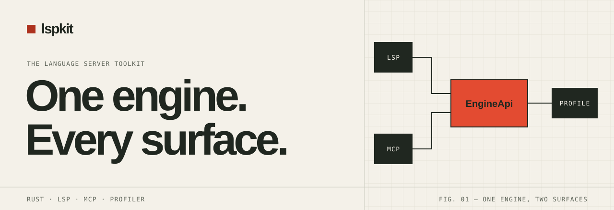
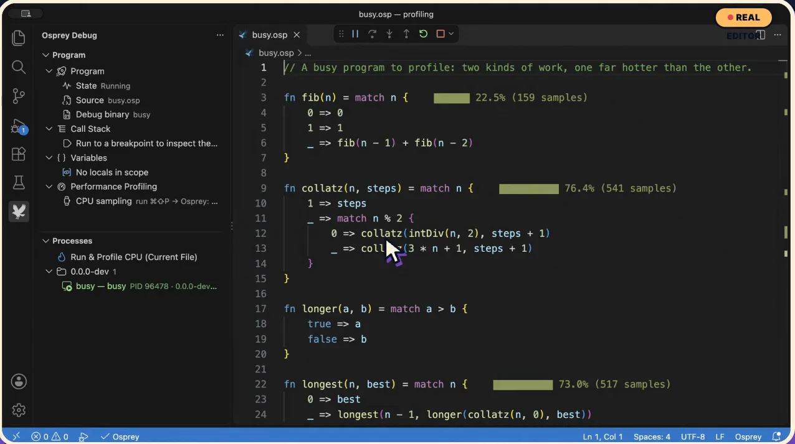
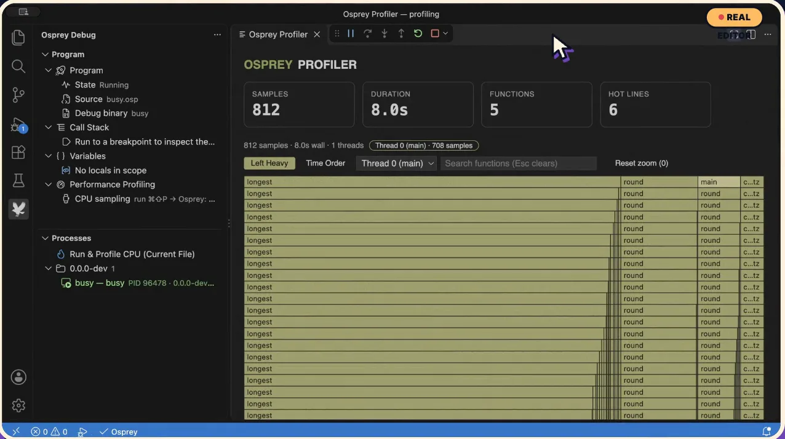

<!-- [WEB-DESIGN-LOGO] The approved PNG mark is shared with the website and docs. -->
<p align="center">
  <a href="https://lspkit.dev"></a>
</p>

<!-- [WEB-DESIGN] Fieldwork design system: paper, ink, one vermilion signal. GitHub strips CSS, so the styling lives in the SVG banner. -->
<p align="center">
  <a href="https://lspkit.dev"></a>
</p>

<p align="center">
  <a href="https://lspkit.dev/docs/"><b>Docs</b></a> &nbsp;·&nbsp;
  <a href="https://lspkit.dev/docs/getting-started/"><b>Getting started</b></a> &nbsp;·&nbsp;
  <a href="https://lspkit.dev/docs/examples/"><b>Examples</b></a> &nbsp;·&nbsp;
  <a href="https://lspkit.dev/blog/"><b>Journal</b></a>
</p>

<p align="center">
  <a href="https://crates.io/crates/lspkit"></a>
  <a href="https://crates.io/crates/lspkit-server"></a>
  <a href="https://crates.io/crates/lsp-profiler"></a>
  <a href="https://www.npmjs.com/package/@nimblesite/lsp-profiler-ui"></a>
  <a href="LICENSE-MIT"></a>
</p>

Rust crates for building language servers. Your analysis runs once, in one engine, and an LSP server, an MCP server and a CPU and memory profiler all read from it.

```sh
cargo add lspkit lspkit-server
```

## What's in the box

<table>
  <tr><th align="left">Crate</th><th align="left">What it gives you</th></tr>
  <tr><td><a href="https://crates.io/crates/lspkit"><code>lspkit</code></a></td><td><code>EngineApi</code> and its types, plus <code>config</code>, <code>vfs</code>, <code>sidecar</code> and, behind <code>treesitter</code>, tree-sitter helpers.</td></tr>
  <tr><td><a href="https://crates.io/crates/lspkit-server"><code>lspkit-server</code></a></td><td>JSON-RPC LSP scaffolding on <code>lsp-types</code>: capabilities, dispatch, diagnostics, progress, cancellation, live file watching and, behind <code>mcp</code>, the MCP adapter.</td></tr>
  <tr><td><a href="https://crates.io/crates/lsp-profiler"><code>lsp-profiler</code></a></td><td>Language-neutral CPU and memory profiler: hotspots, flame graphs, speedscope/V8 export, heap snapshots, leak scoring. <a href="docs/specs/LSP-PROFILER-SPEC.md">Spec</a>.</td></tr>
  <tr><td><a href="https://crates.io/crates/lsp-profiler-dotnet"><code>lsp-profiler-dotnet</code></a></td><td>The profiler's .NET runtime, using EventPipe.</td></tr>
  <tr><td><a href="https://www.npmjs.com/package/@nimblesite/lsp-profiler-ui"><code>@nimblesite/lsp-profiler-ui</code></a></td><td>The VS Code profiler UI: processes, heat map, flame graph, memory dashboard, retention graph, plus Debug Adapter Protocol test glue.</td></tr>
</table>

## Built with lspkit

Two language servers ship the lspkit profiler in VS Code today. Click a picture to watch it run.

<table>
  <tr>
    <td width="50%" valign="top">
      <a href="https://sharplsp.dev/docs/profiler/"></a>
      <p><b><a href="https://sharplsp.dev">SharpLsp</a></b> · C# and F#<br>Attach to any running .NET process. Hot lines light up in your code and leak suspects are ranked live. <a href="https://sharplsp.dev/docs/profiler/">Watch the profiler ▶</a></p>
    </td>
    <td width="50%" valign="top">
      <a href="https://www.ospreylang.dev/docs/tutorials/profiler/"></a>
      <p><b><a href="https://www.ospreylang.dev">Osprey</a></b> · native functional language<br>Run and profile the open file, read the flame graph, attach to a running program and check for leaks. <a href="https://www.ospreylang.dev/docs/tutorials/profiler/">Watch the tutorial ▶</a></p>
    </td>
  </tr>
  <tr>
    <td></td>
    <td></td>
  </tr>
  <tr>
    <td></td>
    <td></td>
  </tr>
</table>

## One engine, two surfaces

`EngineApi` is the single boundary between your analysis and the protocols. The LSP backend and the MCP server consume the same engine, so live analysis state is computed once and served both ways. Every report carries a generation number, so clients know which workspace state produced an answer. `lsp-profiler-python` is parked and unpublished.

## Build

```
make ci      # lint + test + build (full CI simulation)
make test    # fail-fast tests + coverage + threshold
make lint    # cargo clippy -- -D warnings
```

## Spec

Behavior contract: [docs/specs/lspkit-spec.md](https://github.com/Nimblesite/lspkit/blob/main/docs/specs/lspkit-spec.md). Execution plans: [docs/plans/](https://github.com/Nimblesite/lspkit/blob/main/docs/plans/).

## License

MIT — see [LICENSE-MIT](https://github.com/Nimblesite/lspkit/blob/main/LICENSE-MIT). © Nimblesite.
