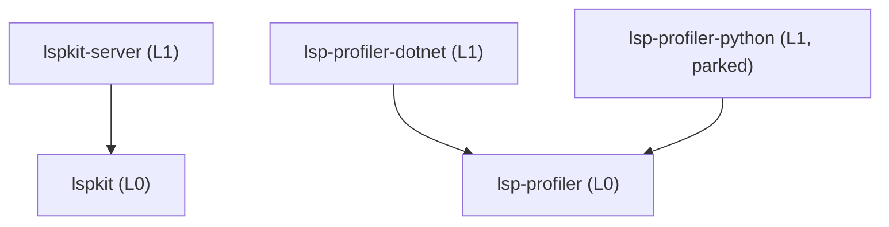

# Plan — consolidate lspkit crates by hierarchy

We are collapsing 12 crates into 5, grouped by dependency layer, and sizing each one near the median popular crate (about 3k lines). The evidence is in [docs/reports/crate-size-survey.md](../reports/crate-size-survey.md). This is a prerequisite for the first tagged release in [publishing-plan.md](publishing-plan.md), because every crate name we publish is permanent.

## Target layout `[CRATE-LAYOUT]`

| Crate | Layer | Absorbs | ~Lines | Published |
|---|---|---|---|---|
| `lspkit` | L0 | `lspkit`, `lspkit-config`, `lspkit-vfs`, `lspkit-treesitter`, `lspkit-sidecar` | 3.8k | yes |
| `lspkit-server` | L1 | `lspkit-server`, `lspkit-live`, `lspkit-mcp` | 8.5k | yes |
| `lsp-profiler` | L0 | — | 6.2k | yes |
| `lsp-profiler-dotnet` | L1 | — | 3.9k | yes |
| `lsp-profiler-python` | L1 | `lsp-profiler-python`, `lsp-profiler-helper` | 12.9k | no (parked) |

- **`[CRATE-LAYOUT-LAYERS]`** An L1 crate depends only on its own tree's L0 crate. An L0 crate has no internal dependencies.
- **`[CRATE-LAYOUT-MODULES]`** Each absorbed crate becomes a top-level module with the same name: `lspkit::config`, `lspkit::vfs`, `lspkit::treesitter`, `lspkit::sidecar`, `lspkit_server::live`, `lspkit_server::mcp`.
- **`[CRATE-LAYOUT-FEATURES]`** `lspkit-server`'s `mcp` cargo feature (default off) keeps the MCP dependency out of LSP-only consumers. `treesitter` and `sidecar` become features of `lspkit` only if their dependencies are heavy.
- **`[CRATE-LAYOUT-HELPER]`** `lsp-profiler-helper` becomes a `[[bin]]` target of `lsp-profiler-python`.

## Retiring published names `[CRATE-RETIRE]`

The six absorbed `lspkit-*` names are already on crates.io at 0.0.1. Audit date: 2026-10-31.

| Crate | Downloads | Reverse deps | Action |
|---|---|---|---|
| `lspkit-config` | 19 | 0 | Delete on crates.io |
| `lspkit-treesitter` | 21 | 0 | Delete on crates.io |
| `lspkit-sidecar` | 20 | 0 | Delete on crates.io |
| `lspkit-mcp` | 20 | 0 | Delete on crates.io |
| `lspkit-live` | 932 | 0 | Delete on crates.io |
| `lspkit-vfs` | 982 | 1 (`lspkit-server` 0.0.1) | `cargo yank --version 0.0.1 lspkit-vfs`, plus a deprecation README pointing to `lspkit::vfs` |

Only a crate owner can delete a crate. Use the Settings → Delete crate page on crates.io, and do it after the consolidated release ships so consumers always have somewhere to go.

## TODO

- [x] Add the `[CRATE-LAYOUT]` and `[CRATE-RETIRE]` sections to [lspkit-spec.md](../specs/lspkit-spec.md), with this plan as the implementation tracker.
- [x] Move `lspkit-config`, `lspkit-vfs`, `lspkit-treesitter` and `lspkit-sidecar` into `crates/lspkit/src/` as modules. Merge their dependencies and tests, and delete the old crate directories.
- [x] Move `lspkit-live` and `lspkit-mcp` into `crates/lspkit-server/src/` as modules, with `mcp` behind a feature.
- [x] Fold `lsp-profiler-helper` into `lsp-profiler-python` as a `[[bin]]`.
- [x] Update the workspace `members`, `exclude` and `[workspace.dependencies]` in `Cargo.toml`, then relock.
- [x] Update every `use lspkit_*` path in this repo, its tests, docs, skills and `coverage-thresholds.json`. Each absorbed crate keeps its floor as a `<crate>::<module>` key (e.g. `lspkit::vfs`), which `_coverage_check` now gates.
- [ ] Update the consumers (SharpLsp, Deslop, Basilisk, lql-lsp-rust) to the new paths.
- [x] Cut the `[REL-ORDER]` publish list in `release.yml`, [publishing-plan.md](publishing-plan.md) and the release setup doc to `lsp-profiler`, `lsp-profiler-dotnet`, `lspkit`, `lspkit-server`.
- [ ] Confirm `make ci` is green and `cargo package --workspace --locked` verifies all 4 published crates. `cargo package` verifies all 4 (2026-10-31). `make ci` is still red on macOS from issues that predate this change: 7 oxlint residuals in `packages/`, `diagnostic_reference unrepresentable` (APFS rejects the `\xff` filename), and `lspkit-server::live` at 92.23% < 94% (the uncovered watcher rescan and `Access` paths are Linux inotify events). Needs a green Linux CI run on the PR.
- [ ] Ship the first tagged release (see [publishing-plan.md](publishing-plan.md)).
- [ ] Retire the old names per `[CRATE-RETIRE]`: delete 5 crates on crates.io, and yank and deprecate `lspkit-vfs`.
