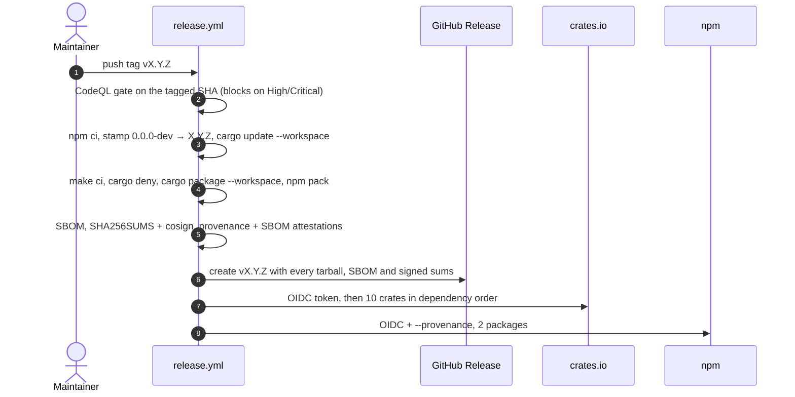

# Plan — release-only publishing for crates.io and npm

Implements `[REL-REGIME]`, `[REL-TRIGGER]`, `[REL-VERSION]`, `[REL-GATES]`, `[REL-GITHUB]`, `[REL-OIDC]`, `[REL-ORDER]`, `[REL-METADATA]`, `[REL-PACKAGED-BUILD]` and `[REL-DEPENDABOT]` from [docs/specs/lspkit-spec.md](../specs/lspkit-spec.md#release--publishing). The model is Shipwright's deployment contract plus the AgentPMO `[CI-WORKFLOWS]` standard: CI gates pull requests, and only a version tag ships.

## How to cut a release

```bash
# From an up-to-date main that CI has already passed:
gh release create v0.1.0 --target main --generate-notes
# or: git tag -s v0.1.0 -m "lspkit 0.1.0" && git push origin v0.1.0
```

Then approve the `release` environment gate on the workflow run. To retry after a failure, re-run the failed workflow run. Both publish wrappers skip versions already on the registry, and the GitHub Release step refreshes assets in place.

## Release flow



## Rollback

Neither registry allows deleting a version. On crates.io, `cargo yank --version X.Y.Z -p <crate>`. On npm, `npm deprecate <pkg>@X.Y.Z "<reason>"`. Then fix forward on `main` and tag a new patch.

## TODO — one-time setup (manual, outside the repo)

- [x] `release` environment exists and only deploys from tags matching `v*.*.*`.
- [ ] Add a required reviewer to the `release` environment (Settings → Environments → release).
- [ ] **Bootstrap the four packages that are not on a registry yet.** Trusted Publishing can only be configured on a package that already exists, so each of these needs one manual publish with a short-lived token: `lsp-profiler` and `lsp-profiler-dotnet` on crates.io, and `@nimblesite/lsp-profiler-ui` and `@nimblesite/lspkit-debug` on npm. Publish `0.0.1`, the version already used by the other eight crates.
- [ ] crates.io: add a Trusted Publisher to all ten crates (owner `Nimblesite`, repo `lspkit`, workflow `release.yml`, environment `release`).
- [ ] npm: add the same Trusted Publisher to both `@nimblesite/*` packages. Then set "Require two-factor authentication and disallow tokens".
- [ ] Delete any `CARGO_REGISTRY_TOKEN` or `NPM_TOKEN` secrets from the repository and its environments.
- [ ] Merge this regime to `main`. Then cut the `dependabot-upgrades` branch from `main` and leave it unprotected. Both branches must carry `dependabot-automerge.yml`.
- [ ] Code security settings: enable Dependabot alerts and security updates, and use the advanced CodeQL setup (turn off default setup).
- [ ] Branch protection on `main`: require the `CI` check and pull requests; no direct pushes.
