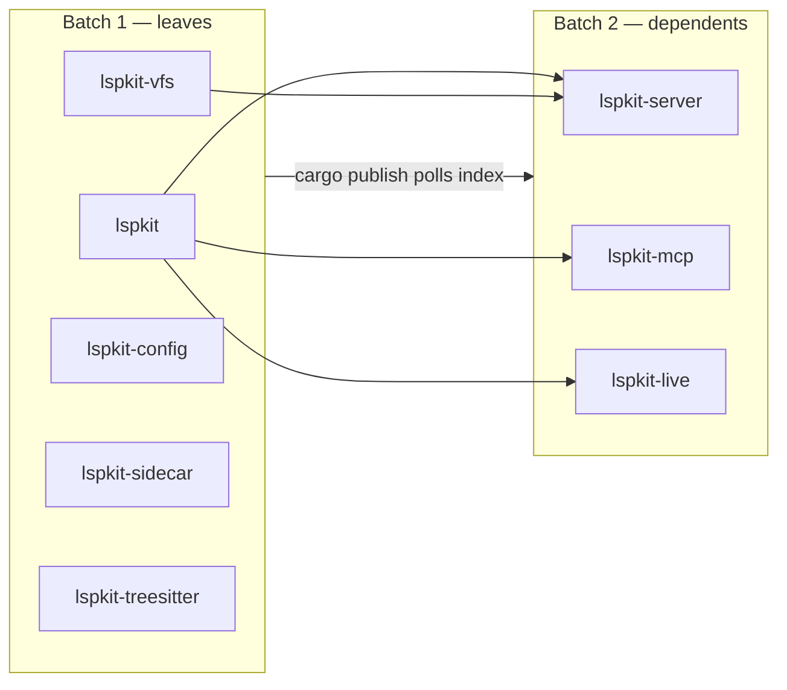
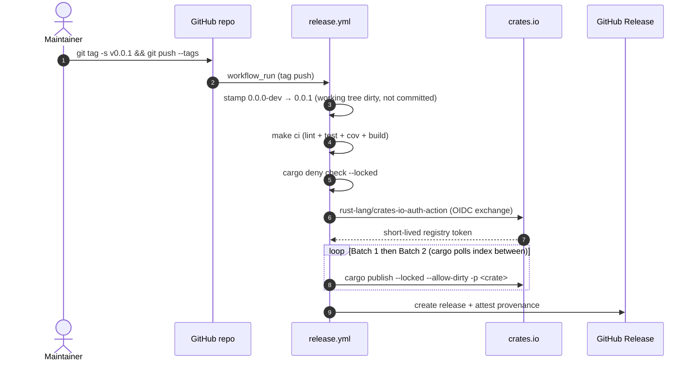
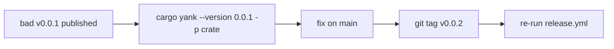

# Plan — Publish `lspkit-*` to crates.io tonight

Implements [REL-TRIGGER], [REL-OIDC], [REL-VERSION], [REL-ORDER], [REL-GATES], [REL-METADATA] from [docs/specs/lspkit-spec.md](../specs/lspkit-spec.md). Approach modelled on Shipwright's release pipeline; OIDC mechanism per `rust-lang/crates-io-auth-action` (GA 2025).

## Dep graph → publish order

Topo sort of internal deps. Publish leaves first, dependents second. **No sleep** between batches — `cargo publish` >= 1.66 polls the sparse index itself until the just-published crate is resolvable (see Shipwright [release.yml:156–158](../../../Shipwright/.github/workflows/release.yml#L156-L158)), so the next `cargo publish` resolves its `lspkit-*` workspace deps without a manual wait.



## Release flow



## Source-of-truth versioning

- `[workspace.package].version = "0.0.0-dev"` in [Cargo.toml](../../Cargo.toml).
- Every crate's `Cargo.toml` uses `version.workspace = true` (already true).
- `[workspace.dependencies]` pins for `lspkit-*` use `version = "0.0.0-dev"` matching the placeholder; the stamp step rewrites both the package version *and* the internal `[workspace.dependencies]` pins with `toml_edit` so structural rewrite is exact (no sed, no regex on TOML).
- Stamp is workflow-only; never committed back to `main`.

## OIDC trusted publisher registration

Per [REL-OIDC], each of the eight crates needs a Trusted Publisher row on crates.io before the first release. Settings → `Trusted publishers` → `Add GitHub publisher`:

| Field | Value |
|---|---|
| Owner | `Nimblesite` |
| Repository | `lspkit` |
| Workflow filename | `release.yml` |
| Environment | `release` |

Until a crate exists on crates.io, the publisher is registered as a **pending** trusted publisher at `https://crates.io/settings/pending-trusted-publishers`. First publish reserves the name and graduates the publisher.

## Workflow skeleton (`.github/workflows/release.yml`)

Mirrors Shipwright's [release.yml](../../../Shipwright/.github/workflows/release.yml) — identical permission shape, identical action pin, identical idempotent-publish wrapper. Per-crate steps are explicit (not a loop) so failures bisect by step name.

```yaml
name: Release
on:
  push:
    tags:
      - 'v[0-9]+.[0-9]+.[0-9]+'
      - 'v[0-9]+.[0-9]+.[0-9]+-*'

concurrency:
  group: release-${{ github.ref }}
  cancel-in-progress: false

# Top-level: id-token: write so any job in this workflow can mint an OIDC
# token. Job-scoping is fine too; Shipwright uses top-level because it
# also publishes npm/NuGet OIDC. We only publish crates, but keep parity.
permissions:
  contents: read
  id-token: write

jobs:
  publish:
    name: Publish to crates.io
    runs-on: ubuntu-latest
    timeout-minutes: 30
    environment: release            # MUST match the crates.io trusted-publisher row
    steps:
      - uses: actions/checkout@df4cb1c069e1874edd31b4311f1884172cec0e10  # v6.0.3
      - uses: dtolnay/rust-toolchain@3c5f7ea28cd621ae0bf5283f0e981fb97b8a7af9  # stable
        with: { toolchain: stable, components: rustfmt,clippy,llvm-tools-preview }
      - uses: Swatinem/rust-cache@<SHA>
        with: { shared-key: release }
      - uses: taiki-e/install-action@59012be0884e296ca2da49b530610e72c49039ad  # v2
        with: { tool: cargo-llvm-cov,cargo-nextest,cargo-deny }

      # DIAGNOSTIC (keep for first releases; remove once stable). Prints the
      # exact OIDC claims crates.io will match against your Trusted Publisher
      # row. Compare repository / workflow_ref / environment / ref char-by-char
      # if the publish step ever returns "invalid trusted publisher".
      - name: Decode OIDC claims (diagnostic)
        run: |
          RESP=$(curl -sf -H "Authorization: bearer $ACTIONS_ID_TOKEN_REQUEST_TOKEN" \
            "${ACTIONS_ID_TOKEN_REQUEST_URL}&audience=crates.io") || { echo "claim fetch failed"; exit 0; }
          echo "$RESP" | python3 -c "import sys,json,base64; t=json.load(sys.stdin)['value']; p=t.split('.')[1]; p+='='*(-len(p)%4); c=json.loads(base64.urlsafe_b64decode(p)); print(json.dumps({k:c.get(k) for k in ['repository','repository_owner','workflow_ref','job_workflow_ref','environment','ref','ref_type']}, indent=0))"

      # Stamp dirties the working tree on purpose. `--allow-dirty` is required
      # on every cargo publish call downstream because we never commit the bump.
      - name: Stamp workspace version from tag
        run: scripts/stamp-version.sh "${GITHUB_REF_NAME#v}"

      - name: CI gate
        run: make ci

      - name: Supply-chain gate
        run: cargo deny check --locked

      # OIDC → short-lived registry token. The action sets `audience=crates.io`
      # for you; the GitHub OIDC token signs the claim, crates.io verifies the
      # Trusted Publisher row, returns a token in steps.crates_auth.outputs.token.
      # No CARGO_REGISTRY_TOKEN secret stored anywhere.
      - name: Authenticate to crates.io via OIDC
        id: crates_auth
        uses: rust-lang/crates-io-auth-action@bbd81622f20ce9e2dd9622e3218b975523e45bbe  # v1.0.4

      # Batch 1 — leaves (no internal lspkit-* deps). cargo publish (>=1.66)
      # polls the index after upload, so the next step resolves cleanly.
      - name: Publish lspkit
        run: scripts/cargo-publish-or-skip.sh lspkit
        env: { CARGO_REGISTRY_TOKEN: "${{ steps.crates_auth.outputs.token }}" }

      - name: Publish lspkit-vfs
        run: scripts/cargo-publish-or-skip.sh lspkit-vfs
        env: { CARGO_REGISTRY_TOKEN: "${{ steps.crates_auth.outputs.token }}" }

      - name: Publish lspkit-config
        run: scripts/cargo-publish-or-skip.sh lspkit-config
        env: { CARGO_REGISTRY_TOKEN: "${{ steps.crates_auth.outputs.token }}" }

      - name: Publish lspkit-sidecar
        run: scripts/cargo-publish-or-skip.sh lspkit-sidecar
        env: { CARGO_REGISTRY_TOKEN: "${{ steps.crates_auth.outputs.token }}" }

      - name: Publish lspkit-treesitter
        run: scripts/cargo-publish-or-skip.sh lspkit-treesitter
        env: { CARGO_REGISTRY_TOKEN: "${{ steps.crates_auth.outputs.token }}" }

      # Batch 2 — depend on Batch 1.
      - name: Publish lspkit-server
        run: scripts/cargo-publish-or-skip.sh lspkit-server
        env: { CARGO_REGISTRY_TOKEN: "${{ steps.crates_auth.outputs.token }}" }

      - name: Publish lspkit-mcp
        run: scripts/cargo-publish-or-skip.sh lspkit-mcp
        env: { CARGO_REGISTRY_TOKEN: "${{ steps.crates_auth.outputs.token }}" }

      - name: Publish lspkit-live
        run: scripts/cargo-publish-or-skip.sh lspkit-live
        env: { CARGO_REGISTRY_TOKEN: "${{ steps.crates_auth.outputs.token }}" }
```

## Helper scripts

Both Bash, both `set -uo pipefail`, both idempotent. Lifted directly from Shipwright's [scripts/cargo-publish-or-skip.sh](../../../Shipwright/scripts/cargo-publish-or-skip.sh).

`scripts/stamp-version.sh <version>` — uses `toml-cli` (or `toml_edit` via a tiny Rust shim) to rewrite `[workspace.package].version` and every `lspkit-*` row under `[workspace.dependencies]` with the exact `<version>`. Structural rewrite only, never regex on TOML. Verifies all eight crate manifests resolve identically.

`scripts/cargo-publish-or-skip.sh <crate>` — one crate per invocation; treats `already uploaded` / `already exists` as success so reruns are safe:

```bash
#!/usr/bin/env bash
set -uo pipefail
crate="${1:?usage: $0 <crate-name>}"
output=$(cargo publish --locked --allow-dirty -p "$crate" 2>&1)
code=$?
printf '%s\n' "$output"
if [ "$code" -ne 0 ] && printf '%s' "$output" | grep -qE 'is already uploaded|already exists'; then
    printf '::notice::%s at this version is already on crates.io — skipping\n' "$crate"
    exit 0
fi
exit "$code"
```

`--allow-dirty` is mandatory: the stamp step mutates `Cargo.toml`/`Cargo.lock` without committing (source keeps the `0.0.0-dev` placeholder), so the working tree is intentionally dirty at publish time.

## Metadata gap to close before first tag

Every crate's `Cargo.toml` currently lacks `description`, `readme`, `documentation`, and `keywords`. `cargo publish` will fail without `description`. Each needs:

```toml
description = "<one-line per crate>"
readme = "README.md"           # workspace-root README is fine; cargo packages it
documentation = "https://docs.rs/<crate>"
keywords = ["lsp", "mcp", "language-server"]   # ≤5
categories = ["development-tools"]             # validate against crates.io list
```

The `LICENSE-MIT` and `LICENSE-APACHE` files at the workspace root need to be readable from each crate dir at package time — set `license-file` is **not** needed since SPDX `license` is set; `include = ["src/**/*", "../../LICENSE-*", "README.md"]` per crate keeps published tarballs lean.

## Rollback

Crates.io does not allow unpublishing past a 72-hour window; even within it, only yanking is supported. Therefore rollback is **yank + new patch**:



Yanking is reversible (`cargo yank --undo`); deletion is not. Plan for forward fixes only.

---

## TODO — going live tonight

Order matters; each line is one PR or one step. Strike through when done.

### Pre-release setup (must land before tag)

- [ ] Change `[workspace.package].version` in [Cargo.toml](../../Cargo.toml) from `0.0.1` → `0.0.0-dev`.
- [ ] Change every `lspkit-*` row under `[workspace.dependencies]` in the same file from `version = "0.0.1"` → `version = "0.0.0-dev"`.
- [ ] Add `description`, `readme = "../../README.md"`, `documentation`, `keywords`, `categories`, `include` to each of the eight `crates/lspkit*/Cargo.toml` files.
- [ ] Add workspace-root `LICENSE-MIT` and `LICENSE-APACHE` (the `Cargo.toml` already declares `MIT OR Apache-2.0`).
- [ ] Add `deny.toml` at repo root with advisory/license/source/bans tables; minimum: deny `unsafe-code`, deny unmaintained, allow `MIT/Apache-2.0/BSD-*/Unicode-DFS-2016/CC0-1.0`.
- [ ] Add `scripts/stamp-version.sh` (uses `toml-cli`; rewrites `[workspace.package].version` and `lspkit-*` rows under `[workspace.dependencies]`; verifies all eight resolve identically).
- [ ] Add `scripts/cargo-publish-or-skip.sh` (copy from Shipwright; one crate per call; idempotent skip on `already uploaded`/`already exists`; `--allow-dirty --locked`).
- [ ] Add `.github/workflows/release.yml` per the skeleton above; pin every `uses:` to a 40-char commit SHA; declare `environment: release`.
- [ ] Create a `release` Environment in repo settings → Environments; add maintainer as required reviewer; restrict to tags matching `v*.*.*`.
- [ ] Configure Dependabot for GitHub Actions in `.github/dependabot.yml` (so SHA pins get PR'd forward).

### crates.io trusted publisher registration (one-time, all eight crates)

- [ ] `lspkit` — register pending trusted publisher (owner `Nimblesite`, repo `lspkit`, workflow `release.yml`, env `release`).
- [ ] `lspkit-vfs` — same.
- [ ] `lspkit-config` — same.
- [ ] `lspkit-sidecar` — same.
- [ ] `lspkit-treesitter` — same.
- [ ] `lspkit-server` — same.
- [ ] `lspkit-mcp` — same.
- [ ] `lspkit-live` — same.

### Rehearsal (local, no token needed)

- [ ] Run `scripts/stamp-version.sh 0.0.1` locally; confirm `grep -r 0.0.0-dev crates/ Cargo.toml` returns zero.
- [ ] Run `for c in lspkit lspkit-vfs lspkit-config lspkit-sidecar lspkit-treesitter lspkit-server lspkit-mcp lspkit-live; do cargo publish --dry-run --locked --allow-dirty -p $c; done` locally; all eight crates pass.
- [ ] `git restore Cargo.toml crates/*/Cargo.toml` to undo the stamp (the workflow re-stamps on its own checkout).

### Go-live

- [ ] Merge all the above into `main`; CI green.
- [ ] `git tag -s v0.0.1 -m "lspkit 0.0.1"` and `git push origin v0.0.1`.
- [ ] Watch `release.yml`; approve the `release` environment gate.
- [ ] Verify all eight crates appear at `https://crates.io/crates/lspkit*` with version `0.0.1`.
- [ ] Verify `https://docs.rs/lspkit` (and the seven siblings) builds within ~30 min.
- [ ] Verify the GitHub Release page lists the tag with auto-generated notes.

### Post-release (next day)

- [ ] Bump consumer repos ([lql-lsp-rust](https://github.com/Nimblesite/lql-lsp-rust), Basilisk, Deslop, SharpLsp) to depend on `lspkit-* = "0.0.1"` from crates.io instead of `path = "..."`.
- [ ] Open follow-up issue: `lspkit-vfs::edit::position_to_byte` UTF-8 branch missing bounds-check on `pos.character` — return `EditError::OutOfBounds` instead of letting `ropey` panic. (Latent from the bootstrap PR.)
- [ ] Open follow-up: provenance/SBOM attestation for crates.io packages once `actions/attest-sbom` lands stable support for Rust.
