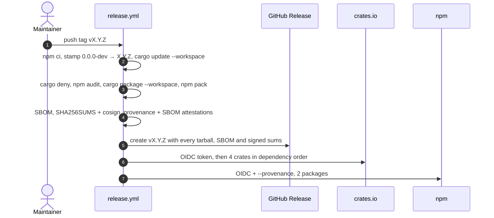

# Plan — release-only publishing for crates.io and npm

Implements `[REL-REGIME]`, `[REL-TRIGGER]`, `[REL-VERSION]`, `[REL-GATES]`, `[REL-GITHUB]`, `[REL-OIDC]`, `[REL-ORDER]`, `[REL-METADATA]`, `[REL-PACKAGED-BUILD]` and `[REL-DEPENDABOT]` from [docs/specs/lspkit-spec.md](../specs/lspkit-spec.md#release--publishing). The model is Shipwright's deployment contract plus the AgentPMO `[CI-WORKFLOWS]` standard: CI gates pull requests, and only a version tag ships.

One-time setup and the release command live in [docs/release-setup.md](../release-setup.md).

## Release flow

## Rollback

Neither registry allows deleting a version. On crates.io, `cargo yank --version X.Y.Z -p <crate>`. On npm, `npm deprecate <pkg>@X.Y.Z "<reason>"`. Then fix forward on `main` and tag a new patch.

## TODO

- [x] Release-only triggers: `ci.yml`, `supply-chain.yml` and `codeql.yml` run on PRs (plus a weekly cron for the scanners), and `release.yml` runs on `v*` tags.
- [x] Source versions are `0.0.0-dev`, stamped from the tag.
- [x] `release.yml` runs no tests; it runs cargo-deny, `npm audit` and `cargo package --workspace`. It then produces the SBOM, cosign-signed `SHA256SUMS`, provenance attestations and the GitHub Release, and publishes 4 crates and 2 npm packages via OIDC.
- [x] `lsp-profiler` builds from its published tarball ([PROF-WIRE-PACKAGED]).
- [x] Dependabot staging branch config and auto-merge workflow.
- [x] zizmor and osv-scanner (Cargo.lock + both npm lockfiles) in `supply-chain.yml`.
- [x] The `release` environment only deploys from `v*.*.*` tags.
- [ ] Manual steps 1–4 in [docs/release-setup.md](../release-setup.md).
- [ ] First tagged release (`v0.0.2`).
