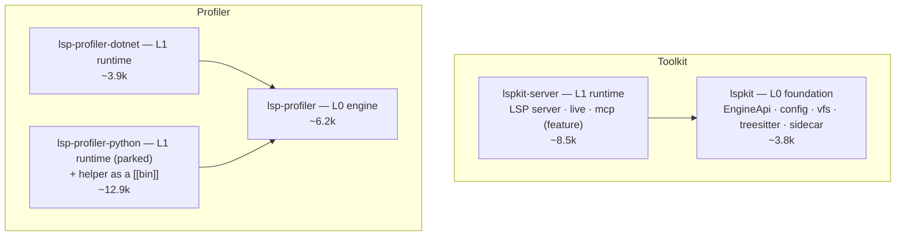

# Crate size survey and proposed lspkit crate hierarchy

How big is a typical Rust crate, and how should lspkit's 12 crates collapse to match? Measured 2026-10-31.

## Method

Nobody publishes a lines-of-code distribution for crates.io, so we measured one. We downloaded each crate's published `.crate` tarball from `static.crates.io`, counted non-blank lines in every `.rs` file, then deleted the tarball.

- **Popular:** the 199 most-downloaded crates (crates.io API, `sort=downloads`).
- **Random:** 83 crates, each picked at random from the results of a crates.io search for a random dictionary word. The top-199 crates were excluded.

## Results (non-blank Rust lines per crate)

| Sample | n | p10 | p25 | **median** | p75 | p90 | mean |
|---|---|---|---|---|---|---|---|
| Popular, all `.rs` | 199 | 231 | 759 | **2,958** | 8,278 | 23,820 | 13,116 |
| Popular, `src/` only | 198 | 206 | 656 | **2,328** | 7,747 | 21,069 | 11,695 |
| Random, all `.rs` | 83 | 156 | 558 | **1,436** | 4,872 | 18,474 | 9,196 |
| Random, `src/` only | 81 | 141 | 436 | **1,278** | 4,488 | 21,922 | 8,628 |

Reference points from the popular sample: `cfg-if` 215 · `autocfg` 1.2k · `anstream` 2.5k · `tracing-core` 5.9k · `tower` 12.7k · `ring` 24.9k.

The mean is useless as a target, because a few giants (`syn`, `windows-*`, `ring`) drag it up to 4–9× the median. **Target the popular median: about 3k lines, with anything from about 0.8k to 8k (the popular p25–p75) acceptable.** Crates below about 750 lines are smaller than three-quarters of popular crates.

## lspkit today

| Crate | Lines | Internal deps | vs. popular median |
|---|---|---|---|
| `lspkit-config` | 250 | — | far under |
| `lspkit-treesitter` | 310 | — | far under |
| `lsp-profiler-helper` | 476 | (parked) | far under |
| `lspkit-mcp` | 531 | `lspkit` | far under |
| `lspkit` | 776 | — | under |
| `lspkit-vfs` | 1,011 | — | under |
| `lspkit-live` | 1,037 | `lspkit` | under |
| `lspkit-sidecar` | 1,460 | — | under |
| `lsp-profiler-dotnet` | 3,870 | `lsp-profiler` | on target |
| `lsp-profiler` | 6,180 | — | in range |
| `lspkit-server` | 6,939 | `lspkit`, `lspkit-vfs` | in range |
| `lsp-profiler-python` | 12,471 | (parked) | over |

Eight of the 12 crates are below the popular median, and four are below its p25.

## Proposed structure: by hierarchy

Group crates by **dependency layer**, not by feature. Two trees (toolkit and profiler) with two layers each. Every crate in a layer depends only on the layer below it.

| Proposed crate | Layer | Absorbs | Lines | Rationale |
|---|---|---|---|---|
| `lspkit` | L0 | `lspkit`, `-config`, `-vfs`, `-treesitter`, `-sidecar` | ~3.8k | Every crate with no internal deps. At the median. |
| `lspkit-server` | L1 | `-server`, `-live`, `-mcp` | ~8.5k | Everything that builds on `lspkit`. An `mcp` cargo feature keeps the MCP dependency out of LSP-only consumers. Popular p75. |
| `lsp-profiler` | L0 | — | ~6.2k | Language-neutral engine. Unchanged. |
| `lsp-profiler-dotnet` | L1 | — | ~3.9k | Runtime plugin. Separate so non-.NET servers don't pull it in. |
| `lsp-profiler-python` | L1 | `-python`, `-helper` | ~12.9k | Parked and not published. The elevated helper becomes a `[[bin]]` of its runtime. |

That gives **12 → 5 crates, 4 published**. The published crates average about 5.6k lines and every one sits between the popular p25 and p75.

Consequences:

- The 8 `lspkit-*` names already on crates.io at 0.0.1 shrink to 2.
- Each of the 6 retired names needs a final release that re-exports from the new crate, plus a deprecation notice, then no further releases.
- The `[REL-ORDER]` publish list in `release.yml` drops to `lsp-profiler`, `lsp-profiler-dotnet`, `lspkit`, `lspkit-server`.

## Sources

- crates.io API (`/api/v1/crates`) and `static.crates.io` tarballs, sampled 2026-10-31.
- No published crates.io lines-of-code study was found. Tools such as [cargo-loc](https://rust-digger.code-maven.com/crates/cargo-loc) and [rustloc](https://docs.rs/crate/rustloc/0.5.0) count lines but publish no registry-wide statistics.
