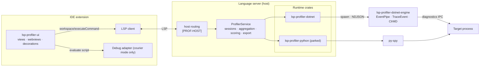

# [PROF] lsp-profiler Specification

**Plan:** [LSP-PROFILER-PLAN.md](../plans/LSP-PROFILER-PLAN.md) · **Wire model:** [profiler.td](../models/profiler.td) · **Command registry:** [profiler-methods.json](../models/profiler-methods.json)

lsp-profiler gives any language server CPU and memory profiling, and gives any IDE extension one UI to drive it. It has two halves:

- **A Rust layer over profiling tools.** Each tool (py-spy, the .NET EventPipe/ClrMD engine, a debuggee-side script, a future native sampler) sits behind a backend trait. Above the backends, one engine does the rest:
  - it owns sessions, aggregation, hotspot and leak scoring, and exports;
  - it produces everything the editor shows, already resolved and ranked.
- **A UI library for IDE extensions.** It renders what the Rust layer produces and forwards the user's actions back. It contains no profiling logic and no knowledge of which language or tool is underneath.

Wherever LSP has a message for something, lsp-profiler uses it ([PROF-LSP]). That lets editors without the UI library still get profiling through their stock LSP client.

## [PROF-INVARIANTS] Hard invariants

A change that violates one of these is wrong, whatever else it achieves.

- **The tool stays behind the backend.** Nothing above `CpuBackend` / `MemoryBackend` names a tool, a language or a runtime. In particular:
  - the core, the wire model and the UI library never branch on a runtime ID;
  - a runtime's differences reach the UI only as capability flags ([PROF-RUNTIME]) and as data.
- **The Rust layer supplies everything the UI needs.** Percentages, rankings, deltas, leak confidence, retention paths, source locations, labels and artifact files are all computed in Rust. The UI library does not aggregate, diff, score, sort semantically or parse anything. It renders and forwards.
- **Standard LSP first.** A custom message exists only where [PROF-LSP] finds no LSP equivalent.
- **No text parsing of tool output where structure exists.** Each backend reads one of:
  - the tool's structured output (NDJSON, JSON, a binary trace through its library);
  - a typed API.

  Scraping human-readable console output (for example SOS `dumpheap` tables) is not a backend.
- **No unwrap, no panic on a live path.** Every failure returns a [PROF-ERRORS] error.
- **Language glue lives only in a runtime crate**: `lsp-profiler-<runtime>` plus that runtime's own tool sources.
- **Every language gets the same profiler.** C#, F#, Python, Dart, Rust: each is one runtime crate behind the traits, and nothing above them — the service, the wire, the LSP surface, the UI library, the tests of those layers — changes per language. A feature that works for one runtime and is absent for another is either a capability flag that runtime reports, or a defect. Languages that share a runtime (C# and F# on the CLR) share the crate.
- **The UI tests move with the UI.** Every test Basilisk's extension had for a screen the library owns runs in the library against a mock server, and every server-backed test runs in each host against that host's real targets, asserting the same behaviour. A host never writes its own copy of a library screen or its tests.

## [PROF-ARCHITECTURE] Architecture

| Component | Location | Role |
|---|---|---|
| `lsp-profiler` | `crates/lsp-profiler` | Core engine: runtime traits, sessions, aggregation, exports, memory scoring, the service |
| `lsp-profiler-dotnet` | `crates/lsp-profiler-dotnet` | .NET runtime: process classification, engine driver, mapping engine output to the neutral model |
| `lsp-profiler-dotnet-engine` | `dotnet/LspProfiler.DotNet.Engine` | C# tool that does the .NET capture and analysis ([PROF-DOTNET-ENGINE]) |
| `lsp-profiler-python` | `crates/lsp-profiler-python` | Python runtime (parked, [PROF-PY]) |
| `lsp-profiler-helper` | `crates/lsp-profiler-helper` | Elevated macOS sampling helper (parked with Python, [PROF-HELPER-PROTOCOL]) |
| `lsp-profiler-ui` | `packages/lsp-profiler-ui` | TypeScript UI library for VS Code-family editors ([PROF-UI]) |

## [PROF-LSP] LSP mapping

Every profiler need maps to a standard LSP mechanism where one exists. The host advertises and routes these ([PROF-HOST]). The service produces the payloads.

| Need | LSP mechanism |
|---|---|
| What can this server profile? | `InitializeResult.capabilities.experimental.lspProfiler` holds `ProfilerCapabilities` ([PROF-RUNTIME]). |
| Every operation: processes, kill, CPU, memory | `workspace/executeCommand` with exactly one argument, the typed params object. The result is the typed result ([PROF-WIRE-METHODS]). Commands are advertised in `executeCommandProvider.commands`. |
| Hot lines, hot functions, allocation sites, growth, leaks | `textDocument/publishDiagnostics` ([PROF-DIAGNOSTICS]), merged by the host with its own diagnostics for the same URI. Pull-model hosts use `workspace/diagnostic/refresh`. |
| Per-line numbers in source ("12.4% CPU", "+3.1 MB/snapshot") | `textDocument/inlayHint`, refreshed with `workspace/inlayHint/refresh` after each report ([PROF-LSP-HINTS]). |
| Per-function and per-type summaries with actions | `textDocument/codeLens`, whose commands are profiler commands; refreshed with `workspace/codeLens/refresh` ([PROF-LSP-LENSES]). |
| Follow-up actions on a hotspot or a leak | `textDocument/codeAction` attached to the profiler diagnostic, for example "Show what keeps `T` alive" ([PROF-LSP-ACTIONS]). |
| Long operations: dump, analysis, symbolization, retention graph | The client's `workDoneToken` gets `$/progress` begin/report/end. Without a token, the server creates one with `window/workDoneProgress/create`. |
| A running CPU session | A server-created work-done progress for the session's whole lifetime, `cancellable: true`. `window/workDoneProgress/cancel` stops the session ([PROF-CPU-PROGRESS]). |
| Cancelling a request | `$/cancelRequest` returns `RequestCancelled` (`-32800`) and terminates every tool process the request started ([PROF-HOST-CANCEL]). |
| Opening an exported artifact | `window/showDocument`: `external: true` for browser viewers, a file URI for `.cpuprofile` / `.heapprofile` ([PROF-EXPORT]). |
| Source positions on the wire | LSP `Location` (`uri` + `range`, zero-based lines) ([PROF-WIRE]). |
| Settings: sample rate, thresholds, autopilot | `workspace/configuration`, section `<prefix>.profiler`, and `workspace/didChangeConfiguration` ([PROF-HOST-CONFIG]). |
| Failures that are not a request's response, such as the target exiting mid-session | `window/showMessage` (Warning). |

Two needs have no LSP equivalent and stay outside it:

- **Evaluating a script in a paused debuggee (courier mode).** That is DAP's job, and the editor runs it ([PROF-MEMORY-MODE]).
- **Rich visualizations.** Flame graphs, the memory dashboard, retention graphs and background heat tint are rendered by [PROF-UI]. That data still arrives through executeCommand results.

Conformance on 2026-10-15: operations, capabilities and cancellation follow this table (`crates/lsp-profiler/src/commands.rs` maps `<prefix>.lspProfiler.<area>.<action>` to the service's internal method keys, which are no longer exposed as requests). Progress is still the `lspProfiler/cpu/progress` notification, diagnostics still travel inside results, hints, lenses, actions and `window/showDocument` are not built, and positions are still 1-based `file` + `line`. The plan tracks each remaining item; until they land, those rows are the target and the code is not yet conformant to them.

### [PROF-LSP-HINTS] Inlay hints

After a CPU report or a memory step, every hot line and every allocation site with a location carries an inlay hint at the end of its line. Hints use `InlayHintKind` none, a short label, and a tooltip with the full numbers. Hints exist only while their session or report is current. Clearing a session refreshes them away.

### [PROF-LSP-LENSES] Code lenses

Hot functions get a lens on their definition line:

- the label is the inclusive and self share;
- the command opens the CPU result at that function.

Types with growth or a suspected leak get a lens on their declaration line:

- the label is the growth and the confidence;
- the command fetches the retention graph.

### [PROF-LSP-ACTIONS] Code actions

A memory diagnostic about type `T` offers "Show what keeps `T` alive" and "List objects of `T`". A CPU diagnostic offers "Open flame graph". Each action is a server command, so editors without the UI library still get a result. Those results are a file or URL opened through `window/showDocument`.

## [PROF-WIRE] Wire model

`docs/models/profiler.td` is the single source of every request, response and notification type. Field names are snake_case on both sides.

- Source positions are LSP `Location`s.
- Runtime identity travels as data (`runtime: "dotnet"`), never as a type distinction.
- Sizes are bytes, durations are seconds, and percentages are 0–100.

### [PROF-WIRE-GEN] Generation

`scripts/typediagram/generate.mjs` emits:

- the Rust types, `crates/lsp-profiler/src/wire_generated.rs` ([PROF-WIRE-GEN-RUST]);
- the TypeScript types, `packages/lsp-profiler-ui/src/wire-generated.ts` ([PROF-WIRE-GEN-TS]).

Comments directly above a type, variant or field become doc comments on both sides ([PROF-WIRE-GEN-DOCS]). Generated files are never edited by hand. A build fails if they are stale.

#### [PROF-WIRE-GEN-RUST] Rust emission

Serde structs and externally tagged enums.

#### [PROF-WIRE-GEN-TS] TypeScript emission

Readonly interfaces and discriminated unions.

#### [PROF-WIRE-GEN-DOCS] Doc comments

A comment block resets at each blank line, so only the block touching a declaration documents it.

### [PROF-WIRE-METHODS] Command registry

`docs/models/profiler-methods.json` names every operation and error code once. Generation emits both as constants for both languages.

The command ID of an operation is `<prefix>.lspProfiler.<area>.<action>`, for example `sharplsp.lspProfiler.cpu.start`.

- The host sets `<prefix>` ([PROF-HOST-CONFIG]). Two servers in one editor can therefore never register the same command.
- The UI library's user-facing commands use `<prefix>.profiler.*` ([PROF-UI-IDS]). Those never collide with server commands, which LSP clients auto-register.

## [PROF-RUNTIME] Runtimes and capabilities

A `Runtime` is one language's set of profiling tools:

- `id` and `display_name`;
- `classify(candidates)` recognises its processes ([PROF-PROCESSES]);
- `frame_filter()` removes its plumbing frames ([PROF-AGGREGATION-SCAFFOLD]);
- `cpu()` returns an optional `CpuBackend`;
- `memory()` returns an optional `MemoryBackend`.

`info()` reports a `RuntimeInfo` with:

- `CpuCapabilities`: `live_progress`, `line_level`, `native_frames`, `cooperative`;
- `MemoryCapabilities`: `mode`, `allocation_sites`, `references`, `objects_by_type`, `gc_collect`.

The UI library derives every enabled action, column and empty state from these flags. A runtime without a capability makes the matching UI absent, not disabled-and-broken.

### [PROF-CPU-BACKEND] CPU backend

`attach(&SamplerConfig) -> SamplerHandle` starts a tool and returns a channel of `SampleBatch`es.

- A batch is one sampling tick: every thread's leaf-first stack, plus an optional `weight_secs` when ticks are not evenly spaced.
- `SamplerHandle::stop` signals the tool and waits up to the handle's finish timeout. That timeout covers tools that symbolize after stopping.
- `cooperative_script` is the optional debuggee-side sampler of [PROF-CPU-COOPERATIVE].

### [PROF-MEMORY-BACKEND] Memory backend

Each step (`start`, `snapshot`, `diff`, `references`, `objects_by_type`, `gc_collect`, `stop`) returns a `MemoryAction`, either:

- `Evaluate { script, output_marker }` in courier mode, whose output comes back through `parse`; or
- `Payload(MemoryPayload)` in direct mode.

Payloads are neutral: `Ack`, `Snapshot`, `Diff`, `Compare`, `Gc`, `Refs`, `Objects`.

A runtime that captures snapshots but cannot diff natively returns `Compare(snapshot)`. The core then computes the diff against the session baseline ([PROF-MEMORY-COMPARE]).

## [PROF-SERVICE] Service

`ProfilerService::new(runtimes, config, events)` is the whole server-side surface.

- It dispatches every [PROF-WIRE-METHODS] operation.
- It owns the CPU and memory session managers.
- It sends server-to-client traffic through the host's `ProfilerEvents`: progress, diagnostics changes and messages.
- `shutdown()` stops every session and terminates every tool process. Hosts call it from their LSP `shutdown` handling.

`ProfilerConfig` carries:

- the command prefix;
- the session cap, which counts CPU and memory sessions together;
- diagnostic branding ([PROF-DIAGNOSTICS-CODES]);
- hotspot thresholds ([PROF-AGGREGATION-THRESHOLD]);
- the artifact output directory.

## [PROF-PROCESSES] Process discovery

The `processes` command reads the OS process table once (`sysinfo`), with no elevation. It offers every candidate to every runtime's `classify`. Each result is a `ProcessInfo` containing:

- `pid`, `ppid`, name and executable;
- the entry (script or assembly);
- the runtime and its version;
- CPU and resident memory;
- user, launcher, workspace membership;
- whether elevation is needed;
- `attachable`, and the reason when it is not.

Attachable processes sort by CPU, and non-attachable ones sort last.

### [PROF-PROCESSES-SCOPE] Scope

Every process a runtime recognises is returned. Workspace membership and debugger plumbing are display attributes, not filters. Logs record counts only, never argv or user names.

### [PROF-PROCESSES-KILL] Kill

The `kill` command terminates a process only when a registered runtime recognises it. A PID that names no process is `PROCESS_NOT_FOUND`; a live process no runtime recognises is `UNSUPPORTED_RUNTIME`, so `kill` can never reach the editor or any other unprofilable process. A whole tree is killed on Windows. The UI asks for confirmation before sending it ([PROF-UI-PROCESSES]).

## [PROF-CPU] CPU profiling

### [PROF-CPU-START] Start

`cpu.start { pid, runtime?, sample_rate?, include_native?, duration?, preset? }`:

1. Resolves the runtime: the one named, or the first whose `classify` accepts the PID.
2. Attaches its CPU backend.
3. Returns `{ session_id, pid, runtime, runtime_version, started_at }`.

A second session on the same PID fails with `ALREADY_PROFILING`. A start beyond the session cap fails with `OTHER`, and the message lists the active sessions. The same cap applies to `memory.start`. A missing PID is invalid: discovery is always explicit.

### [PROF-CPU-PRESETS] Presets

Named presets fill unset parameters: sample rate, native frames and duration. Explicit parameters always win.

### [PROF-CPU-STOP] Stop

`cpu.stop { session_id }` stops the backend, drains every batch, aggregates, exports ([PROF-EXPORT]), publishes diagnostics ([PROF-DIAGNOSTICS-CPU]) and returns the `ProfileReport`.

### [PROF-CPU-SNAPSHOT] Snapshot

`cpu.snapshot { session_id }` returns the same report shape for the data so far, without ending the session.

### [PROF-CPU-SESSIONS] Sessions

`cpu.list` returns every active session with its ID, PID, runtime, version, start time, sample count and duration. A `duration` on start ends the session automatically. Its report is kept for the next `stop` or `list`.

### [PROF-CPU-PROGRESS] Live progress

While a session runs, the service holds a work-done progress for it.

- Begin: "Profiling `<name>` (PID n)".
- A report each second gives the elapsed time, plus the sample count and top function when the backend has `live_progress`.
- Cancelling the progress stops the session exactly as `cpu.stop` would. Its report is then delivered to the UI through `cpu.list`, and published as diagnostics.

### [PROF-CPU-REPORT] Report

A `ProfileReport` contains the session, PID, runtime, duration, total and user samples, the sample rate, and:

- hot functions: inclusive and self share;
- hot lines;
- artifacts.

Diagnostics are not part of the report. They reach the editor only through LSP ([PROF-DIAGNOSTICS]). The same holds for `MemoryResult`.

### [PROF-CPU-COOPERATIVE] Cooperative sampling

When the target cannot be attached from outside, the editor injects the runtime's `cooperative_script` at a debug pause. Today that case is macOS without the elevated helper, for a runtime that advertises `cooperative`. A runtime that samples itself, such as .NET over EventPipe, attaches to a debug-launched program on every platform, once the debuggee reports its process.

The script appends ticks to a minted file, framed one JSON array per line:

`[[thread_id, active, [[file, line, name], …]], …]`

`cpu.cooperativeAttach` tails the file into the normal aggregator. Stopping writes a sentinel and removes the file. Cooperative stacks have no native frames.

## [PROF-SAMPLE] Samples

A `ThreadSample` is a thread ID, an optional name, an active flag and leaf-first `StackFrame`s. A frame has a name, an optional location and an optional module.

### [PROF-SAMPLER] Sampler plumbing

`SamplerHandle::channel(pid, runtime_version, finish_timeout)` gives a backend its parts:

- a sink: a bounded sender plus a stop flag;
- a done signal;
- the handle the session keeps.

Dropping the handle stops the backend.

## [PROF-AGGREGATION] Aggregation

### [PROF-AGGREGATION-STRUCTS] Data

`ProfileData` holds, per file:

- line hits;
- function totals and self counts.

It also holds the total and per-thread tick counts, deduplicated frames, thread names, and per-thread stacks with their weights for export.

### [PROF-AGGREGATION-LOGIC] Logic

Each tick adds one to `total_samples`. A retained thread stack increments each distinct line and function at most once per tick, across every thread's stack, so neither recursion nor a frame every thread shares (a runtime's thread entry point) pushes a share past 100%. The leaf increments self time, also once per tick. Shares are of the ticks that retained at least one stack, reported as `user_samples`. Idle threads count only when `include_idle` is set. Weights come from `weight_secs`, otherwise from `1 / sample_rate`.

### [PROF-AGGREGATION-SCAFFOLD] Runtime filtering

The runtime's `FrameFilter` removes plumbing frames at ingest: interpreter bootstrap, debugger, and the sampler itself. A thread left with only plumbing is dropped. Filtering decides on frame identity (module and path segment), never on substrings of user paths.

### [PROF-AGGREGATION-THRESHOLD] Thresholds

By default a line is hot at 1% and a function at 2%. Each file gets at most 20 diagnostics. All three are configurable.

## [PROF-EXPORT] Exports

On stop, the service writes three files to the output directory:

- speedscope JSON ([PROF-EXPORT-SPEEDSCOPE]);
- a self-contained flame-graph SVG ([PROF-EXPORT-FLAMEGRAPH]);
- a V8 `.cpuprofile` ([PROF-EXPORT-CPUPROFILE]).

An export failure fills `export_error` and never fails the report. The `openArtifact` command opens a file through `window/showDocument`.

### [PROF-EXPORT-VALIDATE] Validation

A profile is refused for export when any of these holds:

- it has zero samples;
- a weight is non-finite or negative;
- a frame index is out of range;
- samples and weights are mismatched.

One guard protects every format.

### [PROF-EXPORT-SPEEDSCOPE] Speedscope

- Frames are deduplicated by name, file and line.
- Leaf-first stacks become root-first samples.
- Each thread becomes a profile, with tick weights.

### [PROF-EXPORT-FLAMEGRAPH] Flame graph

`inferno` renders collapsed stacks to SVG.

### [PROF-EXPORT-CPUPROFILE] V8 CPU profile

The node tree, samples and time deltas, readable by the editor's built-in profile viewer.

## [PROF-DIAGNOSTICS] Diagnostics

The service turns reports and memory results into LSP `Diagnostic`s:

- on a range at the reported line;
- with `source` set to the configured branding;
- with a stable `code`;
- with typed `data` carrying the numbers and the action targets for [PROF-LSP-ACTIONS].

It keeps the current set per URI and tells the host which URIs changed. The host merges them into its own publication ([PROF-HOST-DIAGNOSTICS]). Clearing a session clears its diagnostics.

### [PROF-DIAGNOSTICS-CPU] CPU diagnostics

Hot lines and hot functions with a location become `Hint` diagnostics carrying their share.

### [PROF-DIAGNOSTICS-MEMORY] Memory diagnostics

Memory findings carry their sizes and counts:

- large allocation sites are `Information`;
- growth is `Information`;
- suspected leaks are `Warning`;
- a definite cycle is `Warning`.

A site with no location produces no diagnostic, but still appears in the UI.

### [PROF-DIAGNOSTICS-CODES] Codes

Codes are `<code_prefix>-PROF-LINE`, `-PROF-FUNC`, `-MEM-ALLOC`, `-MEM-GROWTH`, `-MEM-LEAK` and `-MEM-CYCLE`. The prefix comes from the host's `DiagnosticStyle`.

## [PROF-MEMORY] Memory profiling

### [PROF-MEMORY-MODE] Modes

Runtimes use one of two modes:

- **Courier.** The language server cannot reach the heap itself. Each step returns `MemoryStep::Evaluate`:
  1. the UI evaluates the script in the paused debuggee through DAP;
  2. the UI collects output until `output_marker` appears;
  3. the UI posts the output to `memory.ingest`.

  The server never owns a DAP connection.
- **Direct.** The runtime captures the data itself from the PID. Steps return `MemoryStep::Completed` immediately. A direct runtime reads the live heap, which it cannot do while a debugger holds the program paused, so the UI refuses a direct step on a paused debuggee and says to continue. "Run & Track Memory" starts tracking once the debuggee reports its process, with no pause, and takes a baseline snapshot so the run always has a result. When the tracked program ends, its last snapshot opens.

### [PROF-MEMORY-SESSION] Sessions

`MemorySessionManager` owns per-session state: the runtime, the PID, the baseline snapshot, leak history and the timeline. Sessions are independent of CPU sessions.

### [PROF-MEMORY-START] Start

`memory.start { pid, runtime?, traceback_depth? }` first requires a runtime to recognise the PID, with the same codes as `kill` ([PROF-PROCESSES-KILL]), so a refused start leaves no session behind. It then opens a session and returns:

- `{ memory_session_id, runtime, mode, step }`;
- `traceback_depth`, which defaults to 25;
- `max_sites`, which defaults to 50.

### [PROF-MEMORY-STEP] Steps

The `snapshot`, `diff`, `references`, `objectsByType`, `gcCollect` and `stop` commands each return a `MemoryStep`.

### [PROF-MEMORY-INGEST] Ingest

`memory.ingest { memory_session_id, output }` parses courier output with the runtime's `parse`. It scores the payload ([PROF-MEMORY-OUTCOME]) and returns a `MemoryResult`. These are errors:

- an unknown session;
- output with no recognised payload, reported with the delivered text quoted back.

### [PROF-MEMORY-OUTCOME] Outcomes

Scoring maps each payload to a `MemoryOutcome`:

- **Ack** → `Ack`.
- **Snapshot**:
  1. becomes the baseline;
  2. joins the timeline ([PROF-MEMORY-TIMELINE]);
  3. is exported ([PROF-MEMORY-HEAPPROFILE]);
  4. becomes an `Outcome::Snapshot` with the timeline and `trending_upward`.
- **Compare** is diffed against the baseline ([PROF-MEMORY-COMPARE]), then becomes the baseline. Scoring treats the resulting diff as **Diff**.
- **Diff** updates the leak streaks ([PROF-MEMORY-CONFIDENCE]) and becomes `Outcome::Diff` with its suspected leaks.
- **Gc**, **Refs** and **Objects** pass through.

### [PROF-MEMORY-COMPARE] Compare

Sites match by location when they have one, otherwise by type. The diff reports per-site growth in bytes and count, new and freed sites, and net, grown and freed totals.

### [PROF-MEMORY-CONFIDENCE] Leak confidence

| Evidence | Confidence |
|---|---|
| One growth | Low |
| Two consecutive growths, or one growth over 10 MiB | Medium |
| Three consecutive growths | High |
| An uncollectable cycle the runtime reports as such | Definite |

A non-growing diff resets that site's streak. Freed allocations count toward the freed and net totals only.

### [PROF-MEMORY-TIMELINE] Timeline

Every snapshot adds a `TimelinePoint`: elapsed time, current, peak and object counts. `trending_upward` is true when live bytes rose across the recent points.

### [PROF-MEMORY-HEAPPROFILE] Heap profile export

Each snapshot writes a V8 `.heapprofile` built from its sites and tracebacks, for the editor's built-in viewer. Runtime and debugger frames are filtered first.

## [PROF-ERRORS] Errors

| Code | Name | Meaning |
|---:|---|---|
| -32000 | `OTHER` | Session, export or backend failure |
| -32001 | `PROCESS_NOT_FOUND` | No such process, or it exited before attach |
| -32002 | `UNSUPPORTED_RUNTIME` | No registered runtime recognises the process, or it exposes no diagnostics endpoint |
| -32003 | `PERMISSION_DENIED` | Attaching needs privileges the server does not have; the message says how to grant them |
| -32004 | `ALREADY_PROFILING` | The PID already has a CPU session |
| -32005 | `ATTACH_FAILED` | Any other attach failure |
| -32006 | `TOOL_MISSING` | A required tool is not installed; the message says how to install it |
| -32602 | `INVALID_PARAMS` | Malformed parameters |
| -32800 | `RequestCancelled` | LSP cancellation ([PROF-HOST-CANCEL]) |

Every backend maps its tool's failures to these kinds. A tool's raw output is logged at `warn` only when it contains no file contents and no PII. It is never parsed to produce an error kind.

## [PROF-HOST] Hosting in a language server

A host is any language server that embeds `ProfilerService`.

### [PROF-HOST-ROUTING] Routing

On `initialize`, the host adds:

- the profiler's command IDs to `executeCommandProvider.commands`;
- `ProfilerCapabilities` under `experimental.lspProfiler`.

It routes each `workspace/executeCommand` with its prefix to `ProfilerService` and maps errors to the [PROF-ERRORS] codes. Profiler requests never block the host's message loop.

### [PROF-HOST-DIAGNOSTICS] Diagnostics merging

`publishDiagnostics` replaces a URI's whole set. So when the service reports changed URIs, the host republishes each one with its own diagnostics plus the profiler's. Pull-model hosts include the profiler's diagnostics in `textDocument/diagnostic` and send `workspace/diagnostic/refresh`.

### [PROF-HOST-CANCEL] Cancellation

When a request is cancelled, the host drops its future. Every tool process a backend spawns is tied to that future: `kill_on_drop` plus process-tree cleanup. Dropping it therefore terminates the tool and leaves the target running. The response is `-32800`, and the next request works normally.

### [PROF-HOST-CONFIG] Configuration

The host builds `ProfilerConfig` from its own settings source: `workspace/configuration` section `<prefix>.profiler`, or its config file. That covers the command prefix, the diagnostic prefix and source, the thresholds, the output directory and each runtime's tool paths.

### [PROF-HOST-LIFECYCLE] Lifecycle

Sessions live in the host process. They survive anything else the host restarts, such as sidecars or analysis workers, and end on `shutdown` or `exit`.

## [PROF-UI] UI library

`packages/lsp-profiler-ui` is the IDE half. It is one library for every runtime. An extension calls `activateProfiler(host)` and gets the full CPU and memory UI.

### [PROF-UI-HOST] Host injection

The library imports no editor API statically. The host passes in:

- the editor API object;
- the LSP client: `sendRequest` for executeCommand, `onProgress`, and the initialize result;
- the ID prefix and the display name;
- the debug types it may courier through.

The same code then runs in any VS Code-family editor and under test fakes.

### [PROF-UI-STATE] Reactive state

All state lives in `@preact/signals-core` signals in one store:

- processes;
- the CPU session and its last report;
- memory sessions and their results;
- UI preferences.

Views, decorations, context keys and the status item are effects over signals. A view never fetches on its own.

### [PROF-UI-IDS] IDs

Every view ID, command ID, context key, configuration section and webview type is `<prefix>.profiler.*`. Two hosts in one editor (for example Basilisk and SharpLsp) coexist.

### [PROF-UI-CAPABILITIES] Capability gating

The library reads `experimental.lspProfiler`. A runtime without CPU shows no CPU action. A direct-mode runtime shows no debug-session requirement. A runtime without `references` hides retention actions. A runtime's `display_name` labels its rows. A process row opens its `entry` in the editor only when its runtime advertises `source_entries`; an entry that is a binary or an assembly is never opened. The library never branches on a runtime ID.

### [PROF-UI-PROCESSES] Processes view

The processes view shows:

- one row per process: name or entry, PID, runtime and version, CPU, memory, and launcher, workspace and elevation hints;
- for an unattachable process, its reason;
- the active session's marker.

Rows open grouped by runtime version. The group action cycles runtime version → executable → user → parent process → none, then back to runtime version.

Polling is visibility-scoped. Actions resolve an explicit item, then the current selection, and never guess a PID. Kill shows a modal naming the process and PID first.

### [PROF-UI-CPU] CPU results

The results panel shows:

- the summary;
- hot functions and hot lines, which navigate to their source;
- the inline flame-graph SVG, when within the size limit;
- the artifacts to open.

When samples exist but none landed in user code, the panel says the program ran too briefly to sample.

### [PROF-UI-HEATMAP] Heat tint

Source matching resolves filesystem symlinks on every platform, including macOS `/var` aliases and Windows junctions/short names. Windows keys fold case; other platforms preserve it. Missing source files fall back to a resolved path. Canonical keys are cached only for one decoration pass so later filesystem changes cannot leave stale matches.

The numbers come from LSP inlay hints and code lenses ([PROF-LSP-HINTS], [PROF-LSP-LENSES]). The library adds only what LSP cannot express:

- a background tint graded by share;
- CPU on one track, memory on another;
- controlled by a setting.

### [PROF-UI-MEMORY] Memory dashboard

The dashboard shows:

- the timeline chart;
- current, peak and object counts;
- top sites, labelled with the runtime's own type name when it reports one, which navigate to their source;
- the growth table of the last diff;
- suspected leaks with confidence and actions.

An induced GC reports the bytes it freed and any uncollectable objects. `collected` is runtime-defined ([PROF-MEMORY-OUTCOME]), so it is never shown as an object count.

Collection counts (`gc_generations`) and named generation sizes (`generation_sizes`, in bytes) are distinct metrics. Unsupported counts stay empty; the dashboard never presents generation bytes as counts. Generation sizes use the runtime's labels and human-readable byte units. Long type names wrap within the allocation table so Size and Objects remain visible in narrow editor panels.

Snapshot, compare, GC and stop are reachable from the dashboard, the processes view and, in courier mode, the debug toolbar.

### [PROF-UI-REFGRAPH] Retention graph

The retention graph is a layered layout of a `RefGraph`: a node's row is its `depth`, its distance from the targets, so the roots sit on top and the targets along the bottom.

- node radius is logarithmic in size;
- targets, roots and cycles are distinct;
- a root is named by its label above its type, so a static field or an F# module value reads as written (`static sessions`);
- edge labels name the field;
- a row too tight to label each node names its type once, with a count (`40 × App.Session`).

The type picker offers the server's ranked type names (the latest snapshot's top types) plus free text, so it is language-neutral. It never offers names taken from source text or from one language's builtins.

### [PROF-UI-AUTOPILOT] Autopilot

Autopilot runs interval capture (default 30 s) in either mode. With `autoSnapshotOnPause`, a courier runtime is also captured at each genuine debug pause. A direct runtime is never captured around a pause: its heap cannot be read while paused, and a read begun just after a Continue blocks at the next pause, so it is captured on the interval only, and a tick is skipped while the debugger holds the program paused ([PROF-MEMORY-MODE]). The UI reads pauses and resumptions off the host debug adapter's own messages. It reuses snapshot-then-compare and updates the open views in place. The first high-confidence leak in a session offers the retention graph once.

### [PROF-UI-WEBVIEW] Webview host

All panels share:

- one singleton-per-kind lifecycle;
- a nonce-gated CSP;
- `<`-safe JSON embedding;
- source-navigation routing;
- theme variables.

The palette is orange/amber for CPU, purple for memory, red for leaks and green for freed memory, all over editor theme colours.

## [PROF-DOTNET] .NET runtime

Runtime ID `dotnet`, display name ".NET". The `lsp-profiler-dotnet` crate drives `lsp-profiler-dotnet-engine`. The engine is the only code that touches .NET diagnostics APIs.

| Capability | Value |
|---|---|
| CPU `live_progress` | true: the count follows each finished segment, a segment behind ([PROF-DOTNET-CPU]) |
| CPU `line_level` | true: frames carry file and line from portable PDBs |
| CPU `native_frames` | true, on request |
| CPU `cooperative` | false |
| Memory `mode` | Direct |
| Memory `allocation_sites` | false: memory is attributed to types, anchored at the type's declaration, or where the code constructs it ([PROF-DOTNET-SOURCE]) |
| Memory `references`, `objects_by_type`, `gc_collect` | true |

### [PROF-DOTNET-PROCESSES] Classification

A process is .NET when either holds:

- its executable is the `dotnet` muxer; the entry is the first `.dll` argument;
- it is an apphost with a sibling `<name>.runtimeconfig.json`.

Relative executable and assembly paths resolve against the target process's working directory before probing for runtime files. The profiler's own working directory never determines another process's classification.

The runtime version is read from that runtimeconfig by deserializing it: `runtimeOptions.framework(s)[].version`, otherwise `tfm`. A process with no diagnostics endpoint is listed as unattachable, with the reason that diagnostics are disabled or the runtime has not started. On Unix the endpoint is `dotnet-diagnostic-<pid>-*` in the temp directory; on Windows it is the `dotnet-diagnostic-<pid>` named pipe.

### [PROF-DOTNET-ENGINE] Engine

The engine is a framework-dependent C# executable:

- `net8.0`, `RollForward=LatestMajor`;
- built on `Microsoft.Diagnostics.NETCore.Client`, `Microsoft.Diagnostics.Tracing.TraceEvent` and `System.Reflection.Metadata`. It never writes or reads a process dump: on macOS the runtime's `createdump` helper hangs without a debugger entitlement, so a dump-based design would not work the same everywhere, which [PROF-INVARIANTS] forbids.

| Command | Does |
|---|---|
| `cpu --pid N [--native]` | Sample until a line or EOF arrives on stdin, then symbolize and stream ticks |
| `snapshot --pid N --graph PATH [--max-types K] [--buffer-mb M]` | Capture the live heap graph over EventPipe, keep it at `PATH`, summarise it. `M` is the session buffer (default 1024) |
| `analyze --graph PATH [--max-types K]` | Summarise a kept heap graph |
| `refs --graph PATH --type T [--max-depth D] [--max-nodes N]` | Retention graph for live objects of `T` |
| `objects --graph PATH --type T [--limit L]` | Largest live objects of `T`, plus the top types |
| `gc --pid N` | Induce a full blocking collection and report the heap after it |

Every EventPipe session is stopped from the command's own thread, never from inside an event callback: stopping inside the callback deadlocks the event stream.

The exit code is 0 on success. On failure the engine writes exactly one `failure` message and exits 1. Stdout carries only protocol lines. Stderr is for humans and is never parsed.

### [PROF-DOTNET-ENGINE-LOCATE] Locating the engine

The crate looks for the engine in three places, in order:

1. the configured path;
2. `LSP_PROFILER_DOTNET_ENGINE`;
3. `lsp-profiler-dotnet-engine/` next to the host executable.

It runs the engine with a .NET 8+ host. A missing engine or runtime is `TOOL_MISSING`, and the message names what to install.

### [PROF-DOTNET-ENGINE-PROTOCOL] Engine protocol

The engine writes NDJSON, one object per line. Fields are snake_case, and a `kind` discriminator names each message.

| `kind` | Fields | When |
|---|---|---|
| `attached` | `pid`, `runtime_version?` | The CPU session is recording |
| `frames` | `items: [{name, file?, line?, module?}]` | New frame-table entries. IDs continue from the previous message |
| `ticks` | `items: [{weight_ms, threads: [{tid, active, stack: [frame id, leaf first]}]}]` | A batch of ticks; always preceded by the frames they use |
| `stopped` | `tick_count` | Every tick has been sent |
| `snapshot` | `graph_path`, `live_bytes`, `live_objects`, `heap_bytes`, `generation_bytes[gen0, gen1, gen2, loh, poh]`, `types: [{type_name, count, size_bytes, file?, line?}]` | Heap summary |
| `refs` | `nodes`, `edges`, `truncated` | Retention graph |
| `objects` | `type_name`, `total_count`, `total_bytes`, `items`, `type_summary` | Objects of a type |
| `gc` | `observed`, `heap_bytes_after`, `generation_bytes` | Induced collection |
| `failure` | `error_kind` (`ProcessNotFound`, `UnsupportedRuntime`, `PermissionDenied`, `AttachFailed`, `Failed`), `message` | The command failed |

The crate maps `error_kind` one-to-one onto [PROF-ERRORS].

### [PROF-DOTNET-CPU] CPU capture

The engine opens an EventPipe session with rundown and a 256 MB buffer. It enables:

- `Microsoft-DotNETCore-SampleProfiler`, which samples every managed thread each millisecond;
- `Microsoft-Windows-DotNETRuntime` at Informational with keywords `0x14C14FCCBD`: loader, JIT, IL-to-native maps and stacks.

Recording runs in segments, each its own session recorded to a temporary `.nettrace` that is deleted with its `.etlx` on every exit path. The first segment lasts 500 ms and each next one doubles, up to 10 s. A segment ends with its rundown, so its frames can be named. The next segment starts before the last one is symbolized, so the gap between them is only the rundown. Ticks therefore stream a segment behind:

- `cpu.snapshot` sees every finished segment;
- a target that exits keeps every segment it finished. Its last segment never got a rundown, so its frames cannot be named and it is dropped.

The backend reports `live_progress`: each finished segment's ticks advance the session's count, so the count runs a segment behind. A line or EOF on stdin ends the recording. The crate's finish timeout covers symbolizing the last segment.

### [PROF-DOTNET-CPU-SYMBOLS] Symbolization

`TraceLog` converts the trace. A `SymbolReader`, whose path is only the directories the trace's modules were loaded from, resolves each managed frame to its method and its PDB `file`:`line`. Native frames are kept only with `--native`.

Thread samples are grouped into ticks:

- A new tick starts when a thread repeats or more than 0.5 ms passes.
- A tick's weight is the gap to the next tick, capped at 10 ms.
- A thread is active when its sample type is managed execution.

### [PROF-DOTNET-HEAP-CAPTURE] Heap capture

A snapshot is an EventPipe session on `Microsoft-Windows-DotNETRuntime` at Verbose with the keywords `GC`, `Loader`, `Type`, `GCHeapDump`, `GCHeapCollect` and `GCHeapAndTypeNames`, plus rundown. Enabling them makes the runtime perform a full collection and report every surviving object (`GCBulkNode`), reference (`GCBulkEdge`, in node order), root (`GCBulkRootEdge`, `GCBulkRootStaticVar`) and type (`TypeBulkType`); module load and rundown events give each type's assembly path. The engine waits for the induced collection's `GCStop` and the `GCHeapStats` after it (generation sizes), then stops the session. No pause, no dump and no debugger permission are involved, which keeps the capture identical on macOS, Linux and Windows.

The runtime emits the whole heap in one burst during that collection, faster than any reader drains it, so the session buffer must hold the burst. It is 1024 MB, which holds about fourteen million objects. The 256 MB default lost events from about six million. If EventPipe still reports lost events, the snapshot fails (`Failed`) with a message naming how many events were dropped and the buffer size, and no graph is kept. Lost edges cut live objects off from their roots, so a partial graph would report a leaking heap as nearly empty.

### [PROF-DOTNET-HEAP-GRAPH] Heap graph

The captured graph is one JSON file of parallel arrays: types (`name`, `module`), node addresses, sizes and type indices, edge starts/counts and targets, roots (`node`, `kind`, `label`) and generation bytes. Generic names are closed over their arguments (`List`1[App.Payload]`), arrays as `Element[]`. A nested type is named with its declaring chain (`App.Shape+Circle`). The runtime reports only its simple name (`Circle`), so the engine reads the chain from the module's metadata through the type's token. Every F# union case with fields is a nested type, so without this a union case would appear as a bare word with no location. A static root is labelled `static <field>`: the runtime reports a static root's field name and the value's type, not its declaring type. An F# module value `name` lives in a field named `name@<line>`; the label drops the `@<line>` suffix, so it reads `static name`, as in source. The file is the snapshot artifact a memory session keeps between steps, so `refs` and `objects` re-open it instead of touching the target again.

### [PROF-DOTNET-HEAP-MARK] Live heap

The runtime only reports objects that survived the snapshot's collection, but the engine still marks from the roots: static roots are claimed first, so a `static <field>` label wins over an anonymous handle, then every other root. The marking is breadth-first through references. Each node's first parent link is its shortest retention path, and the retention graph for a type is the union of its instances' paths, walked holder by holder until a root or the depth limit. Targets take at most a quarter of the node budget so their holders stay visible.

### [PROF-DOTNET-SOURCE] Type locations

A type's location is the lowest non-hidden sequence point among its methods, read from the assembly's portable PDB. Memory findings about a type anchor there.

Every member F# generates for a record, a union or a union case has only hidden sequence points, so those types have no such point. They anchor instead at the lowest point, in the assembly's own code, where they are constructed:

- a `newobj` of one of the type's constructors (records, closures, anonymous records), including a generic type's constructor reached through a member reference;
- a call to the static `New<Case>` factory F# emits on a union. It constructs the nested `Case` class, or the union itself for a single-case union.

Only methods with visible sequence points are searched, so the generated factories themselves never count. Types without a PDB, such as the framework's, have no location and appear by name only. A location is a file on this machine: a PDB names the documents it was built from, and a package's (FSharp.Core embeds one) names its build server's checkout, so a type whose sequence points all sit in documents absent here has no location either. An array (`Element[]`, `Element[,]`) is the runtime's own type, built wherever a collection grows, so it has no location whatever its element type: a `ResizeArray<Order>` keeps its `Order[]` after `Clear()`, and that array must never paint the line that builds an `Order`.

### [PROF-DOTNET-MEMORY] Memory steps

| Step | Engine | Payload |
|---|---|---|
| `start` | none | `Ack` |
| `snapshot` | `snapshot` | `Snapshot`; sites are live types anchored at their declaration |
| `diff` | `snapshot` | `Compare` |
| `references` | `refs` on the latest graph | `Refs`; an error before any snapshot |
| `objectsByType` | `objects` on the latest graph | `Objects`; the summary ranks the twenty largest types, then adds the requested type's own row when it is too small to rank; an error before any snapshot |
| `gcCollect` | `gc` | `Gc`; `collected` is 1 when a collection was observed, `freed_bytes` is the drop against the last known heap size |
| `stop` | none | `Ack`; deletes the session's graphs |

Graphs live under `<output_dir>/heap-<session>/snapshot-<n>.heapgraph.json`. A graph of half a million objects is about 16 MB.

### [PROF-DOTNET-GC] Induced collection

An EventPipe session with the GC keyword plus `GCHeapCollect` makes the runtime perform a full blocking collection. The engine waits for the collection's `GCStop` and the `GCHeapStats` after it (two seconds of grace), then reports the generation sizes. `observed: false` means no collection completed before the timeout.

### [PROF-DOTNET-PERMISSIONS] Permissions

Same-user processes attach through the diagnostics IPC without elevation. Another user's process returns `PERMISSION_DENIED`, because its endpoint lives under that user's temp directory or ACL. A process started with `DOTNET_EnableDiagnostics=0` returns `UNSUPPORTED_RUNTIME`, with the reason. No step needs a debugger entitlement, `ptrace` or a process dump: CPU sampling and heap capture both ride the IPC channel the runtime opens for its own diagnostics.

## [PROF-PY] Python runtime (parked)

Runtime ID `python`. The code moved from Basilisk into `crates/lsp-profiler-python` (with `crates/lsp-profiler-helper`). It is not a workspace member until it is un-parked. Its citations of the legacy Basilisk IDs map onto the IDs below when it rejoins.

### [PROF-PY-SCAFFOLD] Frame filter

Removes runpy, debugpy/pydevd, the sampler itself and the `threading` bootstrap spine.

### [PROF-PY-PROCESSES] Interpreter detection

Recognises interpreters and probes their versions, with the probing bounded.

### [PROF-PY-CPU-PYSPY] py-spy sampling

CPU sampling through the embedded `py-spy` crate.

### [PROF-PY-CPU-COOPERATIVE] Cooperative sampler

The Python implementation of [PROF-CPU-COOPERATIVE].

### [PROF-PY-PERMISSIONS] Linux permissions

Remedies for ptrace and Yama restrictions.

### [PROF-PY-PERMISSIONS-MACOS] macOS permissions

Remedies for task-port access.

### [PROF-PY-MEMORY-COURIER] Courier scripts

Built on `tracemalloc` and `gc`. Large payloads go through a minted, atomically published file.

### [PROF-PY-MEMORY-INGEST] Ingest markers

Dispatches evaluated output by its marker.

### [PROF-PY-MEMORY-FINAL] Final snapshot

An exit hook writes one last snapshot.

### [PROF-HELPER-PROTOCOL] Elevated helper protocol

The language server and the elevated macOS helper exchange newline-delimited JSON (`HelperCommand` / `HelperMessage`) over a Unix socket.

- The helper reports attach failures as a structured `AttachErrorKind` before it exits.
- EOF falls back to the helper's reaped exit status and stderr.

### [PROF-HELPER-SOCKET] Helper socket lifecycle

The server binds the socket before spawning the helper and accepts one stream. It forwards sample batches into the normal sampler channel. Cleanup removes the socket and the helper.

## [PROF-TESTING] Testing

- Every backend is tested against a real target process the library owns. Consumer fixtures are never copied in. For .NET the targets are `dotnet/fixtures/HotLeakApp` (C#) and its F# twin `dotnet/fixtures/HotLeakAppFs`: a hot loop in `Hot.Spin` (`Hot.spin`), and a leak of `LeakedPayload` held by the static `LeakCache.Items` (the module value `LeakCache.items`). The F# payload is a record holding a union case and a generic record, which are IL shapes C# never emits. The tests assert:
  - CPU: a hot line inside `Hot.Spin` at its `Program.cs` line, and inside `Hot.spin` at its `Program.fs` line;
  - memory: `LeakedPayload` grows across snapshots, reaches Medium then High confidence, and has a retention path ending at root `LeakCache.Items`. In F#, the record, the union case `PayloadKind+Small` and the generic record `Tagged`1[System.Int32]` each anchor at the exact `Program.fs` line that constructs them, and the leak's root is `static items`, with no `@<line>` suffix.
- Every test asserts a specific outcome. A call that only proves something returned is not a test.
- The UI library is tested inside VS Code against a mock language server that speaks the wire (`packages/lsp-profiler-ui/src/test/host`): command registration and advertisement, manifest contributions, settings, reactive state and gating, the processes panel, webview CSP and theming, decorations. Server-backed flows (CPU attach to a live process, heap snapshot and diff, retention graph, induced collection, autopilot) are tested in each host's extension suite against that host's real targets; SharpLsp's are `profiler-cpu-e2e.test.ts` and `memory-e2e.test.ts` against `ProfileTarget` and `ProfileLeakTarget`.
- [PROF-LSP] conformance is tested at the host boundary:
  - commands are advertised;
  - diagnostics merge with the host's own;
  - progress begins and ends;
  - cancellation returns `-32800` and leaves the target alive.
- Coverage is measured per crate and per package. Thresholds live in `coverage-thresholds.json` and only ratchet up.

## [PROF-SCOPE] Scope

| Capability | Status in this spec |
|---|---|
| CPU sampling, line-level hotspots, exports | Required |
| Heap snapshots, compare, leak confidence, retention graph, objects by type, GC | Required |
| LSP-native surfacing ([PROF-LSP]) | Required |
| One UI library for every runtime | Required |
| .NET runtime | Required, first |
| Python runtime | Parked |
| Native (Rust/C/C++) runtime | Not yet specified |
| Live runtime metrics (GC rate, allocation rate, thread pool, exceptions) | Not yet specified: a neutral `metrics` capability is needed before any runtime ships one |
| Opening recorded captures (`.nettrace`, dumps) without a live process | Not yet specified: a neutral `import` command, so recorded files reuse the live pipeline |
| Inspecting one object's fields | Not yet specified |
| .NET allocation sites (sampled allocation stacks) | Not yet specified |
