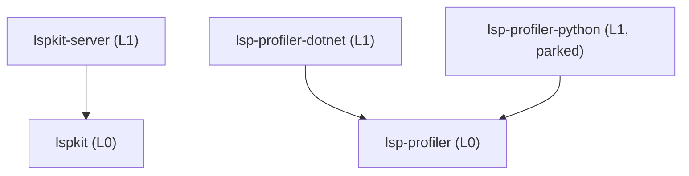

# SPEC — `lspkit`

## Identity

`lspkit` is a public, fully generic Rust workspace published as four crates — `lspkit`, `lspkit-server`, `lsp-profiler` and `lsp-profiler-dotnet` — that supplies the cross-cutting infrastructure every LSP+MCP server reimplements. Its headline contribution is the **"one engine, two surfaces"** contract: a single `EngineApi` trait that an LSP backend and an MCP server both consume, so live analysis state computed once is vended two ways.

## Hard invariants

These are non-negotiable. Any patch violating one is illegal.

- **Generic only.** Toolkit code, docs, READMEs, comments, and examples MUST NOT reference any specific consumer, domain, language ecosystem, or product. A grep for known consumer names returns zero hits in `crates/` and `README.md`.
- **No language-specific backend code.** No Roslyn, FCS, Pyright, Ruff, tree-sitter grammar bundling, nor any other language ecosystem glue lives in any crate. `lspkit::sidecar` is pure transport — its public surface MUST NOT name any backend technology.
- **Maintained bedrock or self-owned.** Toolkit MUST NOT depend on unmaintained crates for core protocol handling. `tower-lsp` is forbidden (last release 2023). The toolkit depends on `lsp-types` (maintained) and ships its own JSON-RPC server loop inside `lspkit-server`.
- **Third-party LSP/MCP types stay hidden.** No `rmcp::*` or `lsp_types::*` request/response type appears in a `pub` signature of `lspkit` or `lspkit-server`. Newtype wrappers are required at every boundary.
- **No wire-format coupling.** The toolkit ships no typeDiagram-generated types. Consumers define their own wire schemas case-by-case.
- **Locks never span `.await`.** `lspkit::vfs` MUST scope all `DashMap` and `Mutex` guards inside synchronous blocks; methods MUST NOT return guards.

## Public crate inventory

Four published crates. The split is locked.

| Crate | Public surface (intent) |
|---|---|
| **lspkit** | Façade. Exposes `EngineApi` trait + `Generation`, `Snapshot<R>`, `GenerationEvent`, `Cause`, `RescanScope`, `RescanTicket` types. Feature `tracing-setup` exposes a stdio-safe `tracing-subscriber` builder. `prelude` module re-exports the headline items. Modules `config` (layered TOML loader), `vfs` (concurrent open-document store), `sidecar` (framed IPC transport) and `treesitter` (parse cache, behind the `treesitter` feature). |
| **lspkit-server** | LSP server scaffolding built on `lsp-types`: Content-Length framing, JSON-RPC request/response/notification dispatcher, capability builder, URI ↔ `PathBuf` helpers, workspace-folders abstraction, diagnostics fan-out bus, progress sink, cancellation plumbing. Consumers register handlers; the crate routes them to an `EngineApi` + VFS pair. Modules `live` (file-watcher → debouncer → single-flight scheduler → session lifecycle) and `mcp` (`rmcp` adapter, behind the `mcp` feature). |
| **lsp-profiler** | Language-neutral CPU and memory profiler core: sessions, hotspots, flame graphs, speedscope/V8 exports, heap snapshots, leak scoring, one JSON-RPC protocol. Spec: [LSP-PROFILER-SPEC.md](LSP-PROFILER-SPEC.md). |
| **lsp-profiler-dotnet** | The profiler's .NET runtime: EventPipe CPU sampling and heap snapshots through the engine in `dotnet/`. |

## Crate layout

Implementation tracker: [docs/plans/crate-consolidation-plan.md](../plans/crate-consolidation-plan.md). The layer graph is under [Dependency direction](#dependency-direction-acyclic).

- **[CRATE-LAYOUT]** The workspace publishes exactly four crates in dependency order: `lsp-profiler`, `lsp-profiler-dotnet`, `lspkit`, `lspkit-server`. `lsp-profiler-python` is parked: it stays in the repo, excluded from the workspace and unpublished.
- **[CRATE-LAYOUT-LAYERS]** An L1 crate depends only on its own tree's L0 crate. An L0 crate has no internal dependencies.
- **[CRATE-LAYOUT-MODULES]** Each absorbed crate becomes a top-level module with the same name: `lspkit::config`, `lspkit::vfs`, `lspkit::treesitter`, `lspkit::sidecar`, `lspkit_server::live`, `lspkit_server::mcp`. Each module keeps its absorbed crate's coverage floor as a `<crate>::<module>` key in `coverage-thresholds.json`.
- **[CRATE-LAYOUT-FEATURES]** Heavy dependency cones are opt-in cargo features, all default off: `lspkit-server/mcp` (`rmcp`), `lspkit-server/pull` (`salsa`), `lspkit/treesitter` (`tree-sitter`, a C runtime) and `lspkit/tracing-setup` (`tracing-subscriber`). `lspkit::sidecar` is always on; its dependencies are already in `lspkit`'s core.
- **[CRATE-LAYOUT-HELPER]** `lsp-profiler-helper` is a `[[bin]]` target of `lsp-profiler-python` (`src/bin/lsp-profiler-helper/`), not a crate.
- **[CRATE-RETIRE]** The six absorbed `lspkit-*` names are already on crates.io at 0.0.1. After the consolidated release ships, delete `lspkit-config`, `lspkit-treesitter`, `lspkit-sidecar`, `lspkit-mcp` and `lspkit-live` on crates.io, and yank `lspkit-vfs` 0.0.1 with a deprecation README pointing to `lspkit::vfs`.

## Dependency direction (acyclic)



## `EngineApi` contract

```rust
#[async_trait::async_trait]
pub trait EngineApi: Send + Sync + 'static {
    type Report: Send + Sync + 'static;
    type Query: Send + Sync;
    type Error: std::error::Error + Send + Sync + 'static;

    fn generation(&self) -> Generation;

    async fn report(
        &self,
        query: Self::Query,
        cancel: CancellationToken,
    ) -> Result<Snapshot<Self::Report>, Self::Error>;

    async fn rescan(
        &self,
        scope: RescanScope,
        progress: Progress,
    ) -> Result<RescanTicket, Self::Error>;

    fn subscribe(&self) -> BoxStream<'static, GenerationEvent>;

    async fn shutdown(&self) -> Result<(), Self::Error>;
}

#[non_exhaustive] pub struct Snapshot<R> { pub generation: Generation, pub data: R }
#[non_exhaustive] pub struct GenerationEvent { pub generation: Generation, pub cause: Cause }
#[non_exhaustive] pub enum RescanScope { All, Paths(Vec<PathBuf>) }
```

### Behavioral guarantees

- **Monotonicity.** `Generation` is strictly increasing for the lifetime of an `EngineApi` instance. Two successful `rescan` calls produce two distinct, ordered generations.
- **Snapshot honesty.** `Snapshot::generation` MUST equal the generation that produced `Snapshot::data`. A consumer comparing snapshot generations across calls can detect staleness.
- **Cancellation propagation.** `report` MUST observe `cancel` and return its error variant for cancellation within a bounded delay. Implementations MUST NOT swallow cancellation.
- **Progress is best-effort.** `rescan` MAY emit zero progress events; consumers MUST handle absence.
- **Subscription liveness.** `subscribe` returns a stream that delivers every `GenerationEvent` for as long as the subscriber polls. A slow consumer MAY miss intermediate events (channel discretion), but the latest `Generation` is always discoverable via `generation()`.
- **Shutdown drains.** `shutdown` MUST NOT return until in-flight `report` / `rescan` calls have observed cancellation and the subscription stream has yielded `None`. After `shutdown` returns, further method calls MUST return `Self::Error`.

## Cross-cutting helpers — required behavior

- **Position encoding** (`lspkit::vfs::PositionEncoding`): negotiates encoding at `initialize` per LSP 3.17 client capabilities; converts on every read; round-trips byte/char offsets correctly across multi-byte scalars and surrogate pairs.
- **URI ↔ `PathBuf`** (`lspkit-server::uri`): handles `file://`, percent-decoding, Windows drive letters, UNC paths, and non-UTF-8 paths.
- **Cancellation** (`lspkit-server::dispatch`): a `CancellationToken` is plumbed through every request handler and triggered when the client sends `$/cancelRequest`.
- **Progress** (`lspkit-server::progress`): wraps LSP `window/workDoneProgress`; the `Progress` sink is a no-op when the client did not advertise the capability.
- **Diagnostics bus** (`lspkit-server::diagnostics`): fan-out from one source to LSP `publishDiagnostics` AND MCP resource-updated notifications, atomically per generation.
- **Workspace folders** (`lspkit-server::workspace`): multi-root aware; `Workspace` exposes folder enumeration and per-folder configuration scope.

## Tech stack (locked)

- `tokio` 1.x, `tracing` + `tracing-subscriber`, `serde` + `serde_derive`, `async-trait`.
- `lsp-types` (current major).
- `rmcp` (current minor, pinned).
- `notify` 7.x, `ropey` 1.x, `dashmap` 6.x, `tokio-util` (for `CancellationToken`).
- `rmp-serde` available as the default wire format for `lspkit::sidecar`; transport is generic over `serde`.
- **No `tower-lsp`.** Ever.

## Public API hygiene

- Every public struct and enum that may grow carries `#[non_exhaustive]`.
- No `pub` fields except on transparent newtypes.
- Extension methods on `EngineApi` live on a sealed `EngineApiExt` trait with a private supertrait, so the toolkit can add helper methods without breaking impls.
- Workspace lint `missing_docs = "deny"`; every public item carries a `///` doc comment.
- Workspace lint `unsafe_code = "deny"`.

## Release & publishing

lspkit runs a **release-only** regime modelled on [Shipwright](https://github.com/Nimblesite/Shipwright/tree/main/docs/specs) and the AgentPMO repo standard. The one way to ship is to push a version tag: [.github/workflows/release.yml](../../.github/workflows/release.yml) gates the tagged commit, cuts a signed GitHub Release and publishes the four crates to crates.io and every package under `packages/` to npm. Spec IDs below are cited by the workflows and by the plan in [docs/plans/publishing-plan.md](../plans/publishing-plan.md).

- **[REL-REGIME]** Workflow triggers are fixed:

  | Workflow | Trigger | Purpose |
  |---|---|---|
  | `ci.yml` | PR to `main` | `make ci` gate |
  | `supply-chain.yml` | PR to `main`, weekly cron | cargo-deny + osv-scanner |
  | `codeql.yml` | PR to `main`, weekly cron, `workflow_call` from release | CodeQL scan; a hard gate when called by release |
  | `release.yml` | push of a `v*` tag | gate, GitHub Release, crates.io, npm |
  | `dependabot-automerge.yml` | Dependabot PR | sweep the bump into `dependabot-upgrades` |

  A push or merge to `main` triggers nothing. Nothing publishes on a schedule, from a branch or from `workflow_dispatch`.
- **[REL-TRIGGER]** A release starts when a tag matching `v[0-9]+.[0-9]+.[0-9]+` (or `v[0-9]+.[0-9]+.[0-9]+-*` for a prerelease) is pushed at a commit on `main`. Publishing a GitHub Release from the UI or with `gh release create vX.Y.Z` creates that tag and so starts the same workflow; the workflow then fills in that release instead of creating a new one.
- **[REL-VERSION]** Every source version is the placeholder `0.0.0-dev`: `[workspace.package].version`, the internal `[workspace.dependencies]` pins and each `packages/*/package.json`. The release stamps the tag version into every carrier with `shipwright-version-stamp` in the runner working tree, and never commits it back. `[SWR-VERSION-BUILD-STAMPING]`
- **[REL-GATES]** Before anything publishes, all of these pass on the tagged commit, in order:
  1. The CodeQL gate (`codeql.yml` with `gate: true`) finds nothing at High or Critical severity.
  2. `make ci` (format, lint, test, coverage thresholds, build).
  3. `cargo deny check advisories bans licenses sources` against the stamped, relocked graph.
  4. `cargo package --workspace --locked` builds every crate tarball against its siblings.

  Every `uses:` is pinned to a 40-character commit SHA. Workflows default to `permissions: contents: read` and elevate per job. Installs are frozen (`npm ci`, `--locked`), and the release job uses no caches.
- **[REL-GITHUB]** The release attaches every crate tarball, every npm tarball, a CycloneDX SBOM and one `SHA256SUMS` over them all, cosign keyless-signed (`SHA256SUMS.sigstore.json`). Build provenance and the SBOM are attested against `SHA256SUMS`, so consumers can run `gh attestation verify <file> --repo Nimblesite/lspkit`. `[SWR-SEC-CHECKSUM]` `[SWR-SEC-PROVENANCE]` `[SWR-SEC-SBOM]`
- **[REL-OIDC]** crates.io and npm both publish through OIDC Trusted Publishing from `release.yml` in the protected `release` environment. The repo stores no `CARGO_REGISTRY_TOKEN` or `NPM_TOKEN`. npm packages also publish with `--provenance`. `[SWR-SEC-OIDC-PUBLISH]`
- **[REL-ORDER]** Crates publish in dependency order: `lsp-profiler`, `lsp-profiler-dotnet`, `lspkit`, `lspkit-server`. `cargo publish` waits for each crate to appear in the index, so no sleeps are needed. npm packages (`@nimblesite/lsp-profiler-ui`, `@nimblesite/lspkit-debug`) publish after the crates. Both publish wrappers skip a version that is already on the registry, so a re-run after a failure partway through is safe.
- **[REL-METADATA]** Every published crate and npm package declares `license = "MIT"` and a repository. The root `LICENSE-MIT` is staged into each crate (`LICENSE-MIT`) and each npm package (`LICENSE`) at publish time, so the declared license ships with the package. `[SWR-REL-LICENSE]`
- **[REL-PACKAGED-BUILD]** A published crate builds without the workspace around it. `lsp-profiler`'s `build.rs` runs the typeDiagram generator only when the workspace generator exists. Otherwise it requires the generated `src/wire_generated.rs` that the crate's `include` packs. `[PROF-WIRE-PACKAGED]`
- **[REL-DEPENDABOT]** Every Dependabot bump lands on the unprotected `dependabot-upgrades` staging branch. CI, CodeQL and supply-chain skip Dependabot PRs, and the batch reaches `main` through one consolidation PR.

## Acceptance — externally verifiable

A patch is acceptable iff:

1. `cargo build --workspace` succeeds from a clean checkout.
2. `cargo test --workspace` runs to completion.
3. `cargo doc --workspace --no-deps` produces docs with zero `missing_docs` warnings.
4. `cargo clippy --workspace -- -D warnings` is clean.
5. `rg -i -e 'basilisk' -e 'deslop' -e 'sharplsp' -e 'lql' -e 'tower-lsp' -e 'roslyn' -e 'pyright' crates/ README.md` returns **zero hits**.
6. `grep -R 'tower_lsp\|rmcp::' crates/*/src/lib.rs` returns **zero hits** in `pub` signatures (manual review against the rule).
7. The `EngineApi` trait skeleton compiles and is exercised by a smoke test that constructs a no-op implementation and calls each method.
8. Each of the four source repos has a "Migration to `lspkit`" section in its AI-guidance file.
9. **[REL-OIDC]** `.github/workflows/release.yml` publishes crates.io (`rust-lang/crates-io-auth-action`) and npm (`--provenance`) under `environment: release`, references no registry token secret, and pins every `uses:` to a 40-char SHA.
10. **[REL-VERSION]** Every source version is `0.0.0-dev`, and the release stamps from `${{ github.ref_name }}`.
11. **[REL-ORDER]** The release publishes all four crates and both npm packages in the order above, through the idempotent skip-if-published wrappers.
12. **[REL-REGIME]** No workflow triggers on `push` to a branch. `actionlint` and `zizmor --min-severity medium` report nothing for `.github/workflows/`.
