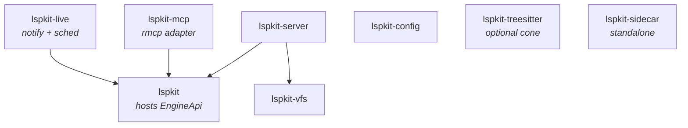

# SPEC — `lspkit`

## Identity

`lspkit` is a public, fully generic Rust workspace published as `lspkit-*` crates that supplies the cross-cutting infrastructure every LSP+MCP server reimplements. Its headline contribution is the **"one engine, two surfaces"** contract: a single `EngineApi` trait that an LSP backend and an MCP server both consume, so live analysis state computed once is vended two ways.

## Hard invariants

These are non-negotiable. Any patch violating one is illegal.

- **Generic only.** Toolkit code, docs, READMEs, comments, and examples MUST NOT reference any specific consumer, domain, language ecosystem, or product. A grep for known consumer names returns zero hits in `crates/` and `README.md`.
- **No language-specific backend code.** No Roslyn, FCS, Pyright, Ruff, tree-sitter grammar bundling, nor any other language ecosystem glue lives in any crate. `lspkit-sidecar` is pure transport — its public surface MUST NOT name any backend technology.
- **Maintained bedrock or self-owned.** Toolkit MUST NOT depend on unmaintained crates for core protocol handling. `tower-lsp` is forbidden (last release 2023). The toolkit depends on `lsp-types` (maintained) and ships its own JSON-RPC server loop inside `lspkit-server`.
- **Third-party LSP/MCP types stay hidden.** No `rmcp::*` or `lsp_types::*` request/response type appears in a `pub` signature of any `lspkit-*` crate. Newtype wrappers are required at every boundary.
- **No wire-format coupling.** The toolkit ships no typeDiagram-generated types. Consumers define their own wire schemas case-by-case.
- **Locks never span `.await`.** `lspkit-vfs` MUST scope all `DashMap` and `Mutex` guards inside synchronous blocks; methods MUST NOT return guards.

## Public crate inventory

Eight crates. The split is locked.

| Crate | Public surface (intent) |
|---|---|
| **lspkit** | Façade. Exposes `EngineApi` trait + `Generation`, `Snapshot<R>`, `GenerationEvent`, `Cause`, `RescanScope`, `RescanTicket` types. Feature `tracing-setup` exposes a stdio-safe `tracing-subscriber` builder. `prelude` module re-exports the headline items. |
| **lspkit-server** | LSP server scaffolding built on `lsp-types`: Content-Length framing, JSON-RPC request/response/notification dispatcher, capability builder, URI ↔ `PathBuf` helpers, workspace-folders abstraction, diagnostics fan-out bus, progress sink, cancellation plumbing. Consumers register handlers; the crate routes them to an `EngineApi` + VFS pair. |
| **lspkit-vfs** | Concurrent open-document store with LSP version tracking, `didOpen` / `didChange` / `didClose` helpers, rope-based incremental edits, and position-encoding negotiation (UTF-8 / UTF-16 / UTF-32). |
| **lspkit-live** | File-watcher → debouncer → single-flight scheduler → session lifecycle. Produces values that implement `EngineApi`. Configurable debounce and quiet windows. Stable `0.0.x` until the watcher/scheduler interplay is proven. |
| **lspkit-mcp** | `rmcp` adapter. Mounts an `EngineApi` impl as MCP tools, resources, and prompts. Provides hooks for tool descriptions that encourage prevention-first agent behavior; the descriptions themselves are consumer-supplied. |
| **lspkit-config** | Layered TOML loader. Walks up from a workspace root, merges LSP `initializationOptions`, exposes an optional hot-reload signal. Generic over the consumer's `serde::Deserialize` config struct. |
| **lspkit-treesitter** | `LanguageParser` trait, content-hash-keyed parse cache, incremental parse helper. Bundles no grammars. Optional dependency cone. |
| **lspkit-sidecar** | Framed IPC primitives only: length-prefixed envelope over Unix-socket / Windows-named-pipe, pluggable wire format, lifecycle manager (spawn, health-ping with timeout, exponential-backoff respawn, request correlation via `AtomicU64` ID). No backend-specific code of any kind. |

## Dependency direction (acyclic)



## `EngineApi` contract

```rust
#[async_trait::async_trait]
pub trait EngineApi: Send + Sync + 'static {
    type Report: Send + Sync + 'static;
    type Query: Send + Sync;
    type Error: std::error::Error + Send + Sync + 'static;

    fn generation(&self) -> Generation;

    async fn report(
        &self,
        query: Self::Query,
        cancel: CancellationToken,
    ) -> Result<Snapshot<Self::Report>, Self::Error>;

    async fn rescan(
        &self,
        scope: RescanScope,
        progress: Progress,
    ) -> Result<RescanTicket, Self::Error>;

    fn subscribe(&self) -> BoxStream<'static, GenerationEvent>;

    async fn shutdown(&self) -> Result<(), Self::Error>;
}

#[non_exhaustive] pub struct Snapshot<R> { pub generation: Generation, pub data: R }
#[non_exhaustive] pub struct GenerationEvent { pub generation: Generation, pub cause: Cause }
#[non_exhaustive] pub enum RescanScope { All, Paths(Vec<PathBuf>) }
```

### Behavioral guarantees

- **Monotonicity.** `Generation` is strictly increasing for the lifetime of an `EngineApi` instance. Two successful `rescan` calls produce two distinct, ordered generations.
- **Snapshot honesty.** `Snapshot::generation` MUST equal the generation that produced `Snapshot::data`. A consumer comparing snapshot generations across calls can detect staleness.
- **Cancellation propagation.** `report` MUST observe `cancel` and return its error variant for cancellation within a bounded delay. Implementations MUST NOT swallow cancellation.
- **Progress is best-effort.** `rescan` MAY emit zero progress events; consumers MUST handle absence.
- **Subscription liveness.** `subscribe` returns a stream that delivers every `GenerationEvent` for as long as the subscriber polls. A slow consumer MAY miss intermediate events (channel discretion), but the latest `Generation` is always discoverable via `generation()`.
- **Shutdown drains.** `shutdown` MUST NOT return until in-flight `report` / `rescan` calls have observed cancellation and the subscription stream has yielded `None`. After `shutdown` returns, further method calls MUST return `Self::Error`.

## Cross-cutting helpers — required behavior

- **Position encoding** (`lspkit-vfs::PositionEncoding`): negotiates encoding at `initialize` per LSP 3.17 client capabilities; converts on every read; round-trips byte/char offsets correctly across multi-byte scalars and surrogate pairs.
- **URI ↔ `PathBuf`** (`lspkit-server::uri`): handles `file://`, percent-decoding, Windows drive letters, UNC paths, and non-UTF-8 paths.
- **Cancellation** (`lspkit-server::dispatch`): a `CancellationToken` is plumbed through every request handler and triggered when the client sends `$/cancelRequest`.
- **Progress** (`lspkit-server::progress`): wraps LSP `window/workDoneProgress`; the `Progress` sink is a no-op when the client did not advertise the capability.
- **Diagnostics bus** (`lspkit-server::diagnostics`): fan-out from one source to LSP `publishDiagnostics` AND MCP resource-updated notifications, atomically per generation.
- **Workspace folders** (`lspkit-server::workspace`): multi-root aware; `Workspace` exposes folder enumeration and per-folder configuration scope.

## Tech stack (locked)

- `tokio` 1.x, `tracing` + `tracing-subscriber`, `serde` + `serde_derive`, `async-trait`.
- `lsp-types` (current major).
- `rmcp` (current minor, pinned).
- `notify` 7.x, `ropey` 1.x, `dashmap` 6.x, `tokio-util` (for `CancellationToken`).
- `rmp-serde` available as the default wire format for `lspkit-sidecar`; transport is generic over `serde`.
- **No `tower-lsp`.** Ever.

## Public API hygiene

- Every public struct and enum that may grow carries `#[non_exhaustive]`.
- No `pub` fields except on transparent newtypes.
- Extension methods on `EngineApi` live on a sealed `EngineApiExt` trait with a private supertrait, so the toolkit can add helper methods without breaking impls.
- Workspace lint `missing_docs = "deny"`; every public item carries a `///` doc comment.
- Workspace lint `unsafe_code = "deny"`.

## Release & publishing

The toolkit ships eight crates to crates.io as a single coordinated release. Rules are non-negotiable; spec IDs below are referenced by the release workflow and the implementation plan in [docs/plans/publishing-plan.md](../plans/publishing-plan.md).

- **[REL-TRIGGER]** Releases are triggered by an annotated tag matching `v[0-9]+.[0-9]+.[0-9]+` (or `v*.*.*-*` for prereleases) pushed to `main`. No `workflow_dispatch`. No publishing from feature branches.
- **[REL-OIDC]** Publishing to crates.io uses OIDC trusted publishing via `rust-lang/crates-io-auth-action`. No `CARGO_REGISTRY_TOKEN` secret is stored in the repo. Each of the eight crates registers `Nimblesite/lspkit` + workflow `.github/workflows/release.yml` + environment `release` as a Trusted Publisher on crates.io.
- **[REL-VERSION]** A single workspace version is the source of truth. `[workspace.package].version` carries the placeholder `0.0.0-dev` in source; the release workflow stamps the tag-derived version into `Cargo.toml` (and the internal `[workspace.dependencies]` pins for `lspkit-*`) before build. All eight crates inherit via `version.workspace = true`. The stamp is never committed back to `main`.
- **[REL-ORDER]** Publish order respects the dep graph above; one 30-second sleep between batches lets the crates.io index propagate:
  1. **Batch 1 (leaves):** `lspkit`, `lspkit-vfs`, `lspkit-config`, `lspkit-sidecar`, `lspkit-treesitter`
  2. **Batch 2 (dependents):** `lspkit-server`, `lspkit-mcp`, `lspkit-live`

  `cargo publish -p <crate>` per crate; the publish step is idempotent (skip if the version is already on the index).
- **[REL-GATES]** Pre-publish gates — all must pass, in order:
  1. `make ci` (lint + test + coverage thresholds + build) green on the tagged commit.
  2. `cargo publish --dry-run -p <crate>` succeeds for each crate.
  3. `cargo deny check` clean against committed `deny.toml`.
  4. Every `uses:` in the release workflow pinned to a 40-char commit SHA (Dependabot tracks).
  5. Top-level workflow `permissions: contents: read`; `id-token: write` job-scoped to the publish job only.
  6. `--locked` on every cargo invocation in the release workflow; `Cargo.lock` committed.
- **[REL-METADATA]** Every published crate carries `license = "MIT"`, `repository`, `description`, `readme`, and `documentation` fields. A single `LICENSE-MIT` file ships in each crate, staged from the workspace-root `LICENSE-MIT` at publish time. The declared SPDX license matches the one license file that actually ships. `[SWR-REL-LICENSE]`
- **[REL-PROVENANCE]** GitHub Release artifacts (if any) carry `actions/attest-build-provenance` attestations. Provenance for crates.io packages is roadmap; not blocking for `0.0.x`.

## Acceptance — externally verifiable

A patch is acceptable iff:

1. `cargo build --workspace` succeeds from a clean checkout.
2. `cargo test --workspace` runs to completion.
3. `cargo doc --workspace --no-deps` produces docs with zero `missing_docs` warnings.
4. `cargo clippy --workspace -- -D warnings` is clean.
5. `rg -i -e 'basilisk' -e 'deslop' -e 'sharplsp' -e 'lql' -e 'tower-lsp' -e 'roslyn' -e 'pyright' crates/ README.md` returns **zero hits**.
6. `grep -R 'tower_lsp\|rmcp::' crates/*/src/lib.rs` returns **zero hits** in `pub` signatures (manual review against the rule).
7. The `EngineApi` trait skeleton compiles and is exercised by a smoke test that constructs a no-op implementation and calls each method.
8. Each of the four source repos has a "Migration to `lspkit`" section in its AI-guidance file.
9. **[REL-OIDC]** `.github/workflows/release.yml` exists, uses `rust-lang/crates-io-auth-action` under `environment: release`, declares no `CARGO_REGISTRY_TOKEN` secret, and pins every `uses:` to a 40-char SHA.
10. **[REL-VERSION]** `[workspace.package].version = "0.0.0-dev"` in source; release workflow stamps from `${{ github.ref_name }}`; every crate uses `version.workspace = true`.
11. **[REL-ORDER]** Release workflow publishes the eight crates in the two batches above with a sleep between, and uses an idempotent skip-if-already-published wrapper.
