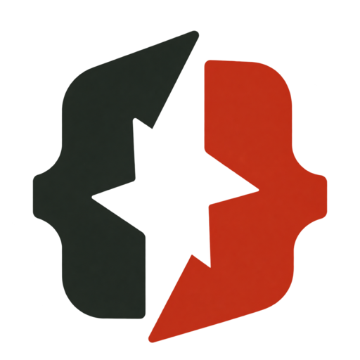

# lspkit / Fieldwork

A compact design system for the toolkit's documentation and engineering journal. The visual idea: an architect's field notebook meets a precision instrument. Warm paper, ink, a single signal colour, and diagrams that make engineering feel tangible.

## [WEB-DESIGN] Art direction

**Confident, precise, open.** Oversized headlines establish a point of view; small monospaced labels supply context. Space is the primary organising device. Thin rules separate sections. Avoid decorative cards, soft shadows, gradients, pill-shaped navigation and marketing statistics.

Use the existing `lspkit` wordmark in lowercase, accompanied by the approved charcoal-and-vermilion PNG brace mark. Headlines use sentence case. Copy is direct and technical, with no invented adoption claims. The homepage leads with “The foundation for any language’s tooling.” and a short explanation of the toolkit.

### [WEB-DESIGN-LOGO] Approved mark

The first approved raster concept is the only logo: two opposing code braces, charcoal on the left and vermilion on the right, with an angular opening and restrained shading. `website/src/assets/images/logo.png` is the transparent 512 px master used by the masthead, root README and repository docs. `favicon.ico` contains 16, 32 and 48 px variants; `apple-touch-icon.png` is 180 px. Small browser icons use a warm ivory background for contrast. The dark website masthead also supplies an ivory backing. All discarded logo options and the old `mark.svg` are removed.

Created with the built-in image generator by isolating option 01 without redesigning it, removing the labels and backdrop, and preserving the exact shape, colours and subtle shading. Icon sizes are derived from the approved PNG.

### [WEB-DESIGN-COLOR] Semantic palette

| Token | Light | Dark | Purpose |
| --- | --- | --- | --- |
| `--color-bg` | `#f4f1e9` | `#191c19` | Paper / canvas |
| `--color-text` | `#202720` | `#f4f1e9` | Ink / primary text |
| `--color-primary` | `#ad321e` | `#ff997f` | Links, focus and active navigation |
| `--color-muted` | `#60665b` | `#b3b9ac` | Metadata and captions |
| `--color-border` | `#c9ccbf` | `#454b41` | Quiet structural rules |
| `--color-panel` | `#e8ebdf` | `#252c24` | Image surround and code |

The illustration uses a stronger vermilion `#e34b31` as an image colour, never as small text on paper. Theme controls preserve the visitor's choice using techdoc's bundled implementation.

### [WEB-DESIGN-TYPE] Typography

Use the local system sans stack (`Arial`, `Helvetica`, sans-serif) for fast, dependable rendering and `SFMono-Regular`, `Consolas`, monospace for labels and code. No remote font requests.

| Role | Size | Treatment |
| --- | --- | --- |
| Hero | fluid 52–104 px | 0.96 line height, −0.065em tracking, bold |
| Page title | fluid 40–72 px | 1.05 line height, −0.05em tracking |
| Section title | fluid 28–44 px | 1.12 line height, −0.04em tracking |
| Body | 18 px | 1.7 line height, maximum 68ch |
| Label | 12 px | monospace, uppercase, 0.1em tracking |

### [WEB-DESIGN-LAYOUT] Grid and rhythm

Content spans at most 1200 px, with 32 px desktop gutters and 20 px mobile gutters. The spacing scale is 4, 8, 12, 16, 24, 32, 48, 64 and 96 px. The hero is a wide text column plus a narrow explanatory column; below 768 px, it becomes one column. Images remain proportional. Use square corners and 1 px dividers.

### [WEB-DESIGN-COMPONENTS] Components

- **Masthead:** small wordmark, Docs / Journal navigation, an outlined theme control. Active links use an underline as well as colour.
- **Hero:** eyebrow, large two-line title, short introduction and underlined text action. No unnecessary call-to-action stack.
- **Header artwork:** an original SVG engineering plate: one central engine routes into two terminal surfaces. Fine grid, dark outlines, vermilion core. Decorative labels belong in the surrounding HTML so they remain readable.
- **Journal row:** issue number, title, excerpt, publication date and arrow. One real example post, sourced from the plugin's collection.
- **Article:** metadata, large heading, full-width header image, narrow body and a clear back link. Use techdoc's shared blog layout.
- **Code:** quiet panel with overflow scrolling; inherit syntax highlighting from techdoc with accessible token colours.
- **Footer:** compact project identity and a link to the repository.

## [WEB-CONTENT] Minimal information architecture

`/` introduces the toolkit and features the example post. `/docs/` explains the architectural basics and links to `/docs/getting-started/`, `/docs/crates/` and `/docs/profiler/`. `/blog/` and the tag/category pages are generated by techdoc. `/blog/one-engine/` contains one short example post with the header image. The plugin also owns the feed, sitemap and structural assets; do not copy its templates into this project.

The canonical origin defaults to `http://localhost:8080` for this local sketch and is configured with `SITE_URL` before a production build. Do not invent a live domain or publish through a new workflow.

### [WEB-EXAMPLES] Built with lspkit

`/docs/examples/` shows the real integrations: SharpLsp and Osprey running the profiler in VS Code. Videos, posters and captions are embedded from each project's own site; Osprey screenshots are frames cropped from its profiler video. The README carries the same showcase as poster images that link to each project's profiler page, and a design-system SVG banner (`readme-hero.svg`) because GitHub strips CSS.

### [WEB-SEO-KEYWORDS] Search keywords

Blog posts target Google Trends keywords, recorded at the top of each post. The current keyword table lives in [messaging](../messaging.md#keywords-web-seo-keywords).

## [WEB-ACCESS] Interaction and acceptance

All actions are real links or buttons. Keep the plugin's skip link, semantic headings and keyboard-operable navigation. Focus uses a visible 3 px outline with an offset. Controls have a minimum 44 px target. Links in prose are underlined. Images have meaningful alternatives; the diagram is also described in the article text. No animation is required.

Check the homepage, docs, blog and article at desktop and 390 px mobile widths, with both colour themes and the mobile menu. Confirm no horizontal overflow, no broken local navigation or assets, valid generated structured data, and a successful Eleventy production build. The design is a starter, not a claim of a full accessibility audit.

## Implementation map

### [WEB-CONTENT-JOURNAL] Journal navigation and listing

The main navigation contains exactly Docs (`/docs/`) and Journal (`/blog/`). Prose is a shared styling class, not a navigation section. The journal index has an accessible header illustration, dated post summaries with H2 titles, and a direct article link. Its two-column desktop rows stack on mobile. The pinned techdoc 0.2 virtual blog index is configured to render `journal.njk`, retaining its collections, article layouts and tag/category routes. The illustration markup is shared with article pages through `header-image.njk`.

### [WEB-ACCESS-PROSE] Shared responsive reading surface

Every docs and blog article body uses an explicit `.prose` class via the shared `prose-content.njk` include. One stylesheet supplies heading hierarchy, lists, quotes, inline code, scrollable code blocks, tables, figures and disclosures; the CSS budget is 2,000 lines.

At 768 px and below, docs navigation becomes an in-flow, wrapping list above the article. It never competes with the main menu as a second overlay. Article columns shrink with `minmax(0, 1fr)`; long tokens wrap, while tables and code scroll within their own containers. Header images preserve their intrinsic aspect ratio and scale to available width. Docs and posts use the shared image include; journal listing headers use the same illustration as a decorative background. Heading permalink links have no underline until hovered or focused.

`website/tests/prose_test.py` drives the real Eleventy build and parses generated HTML to verify navigation, shared stylesheet references, prose classes, header images, the docs pages' content elements and local links, and that no specimen pages ship. These checks do not replace browser viewport and interaction testing.

`website/src/assets/css/styles.css` implements the visual tokens and components. `website/eleventy.config.js` registers `eleventy-plugin-techdoc`; `website/src/_data/` supplies shared metadata. The image is `website/src/assets/images/engine.svg`. Track completion in [the website plan](../plans/website-plan.md).
